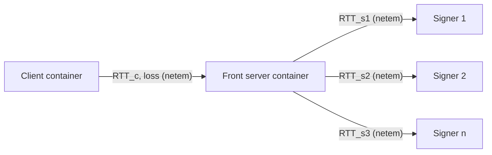

# 실험 설계

용어와 기호는 [problem-definition.md](problem-definition.md) 2절의 정의를 따른다. 대괄호 번호는 [related-work.md](related-work.md)의 참고문헌 번호다. 이 문서의 수치 격자는 초기 제안이며 Phase 1의 첫 측정 결과를 보고 조정한다.

## 1. 변인

### 독립 변인

| 구분 | 변인 | 초기 수준 |
| --- | --- | --- |
| 구현체 | 서버 QUIC 구현체 | 비동기 서명을 지원하는 Cloudflare quiche와 s2n-quic, 동기 서명만 되는 quic-go와 aioquic을 쓴다. 선정 근거는 [related-work.md](related-work.md) 5.2절의 조사표다. quiche, quic-go, aioquic은 서명 지연 서버를 만들어 측정했고 s2n-quic은 아직 만들지 않았다. |
| 구현체 | client QUIC 구현체 | quic-go v0.65.0을 기본 client로 쓴다. 두 번째 client는 Ed25519 검증 지원을 실행으로 확인한 뒤 정한다. |
| 서명 | signature scheme | FROST(Ed25519), Shoup threshold RSA-2048, threshold ECDSA P-256. threshold ECDSA는 아직 구현하지 않았다. |
| 서명 | (t, n) | (1, 1), (2, 3), (3, 5). (1, 1)은 원격 key server 하나를 쓰는 비교 기준이다. signer 선택 정책 비교에는 (2, 5)도 쓴다. |
| 서명 | precomputation | 사용, 미사용 |
| 서명 | signer 선택 정책 | 고정 집합(fixed), RTT_s가 가장 짧은 t개(fastest), n개 전체에 요청 후 먼저 온 t개(first, share가 독립인 threshold RSA에 한정), 가까운 m개의 모든 t개 조합으로 FROST 세션을 동시에 진행(hedge) |
| 서명 | hedge의 폭 m | t부터 n까지 |
| 서명 | hedge 지연 계수와 예산 | 계수 0(처음부터 모든 세션), 1, 1.5, 3. 예산 없음, 0.2 |
| 서명 | ping nudge | 미사용, 지연 계수 1.5, 3 |
| 서명 | signer 간 transport | 유지되는 연결, 요청마다 새 연결 |
| 네트워크 | RTT_c | 1 ms, 20 ms, 100 ms |
| 네트워크 | client와 front server 사이 loss | 0%, 1% |
| 네트워크 | RTT_s | 0 ms(netem 없음), 5 ms, 50 ms. signer마다 다른 값을 주는 배치도 포함한다. |
| 네트워크 | front server와 signer 사이 loss | 0%, 1% |
| 시스템 | front server의 CPU core 수 | 1, 4 |
| 시스템 | 동시 handshake 수 | 1, 10, 100 |
| 시스템 | CPU architecture | x86-64. 다른 architecture는 장비가 확보되면 추가한다. |

### 종속 변인

| 지표 | 정의 | 측정 위치 |
| --- | --- | --- |
| T_hs | client가 연결을 시작한 시각부터 client 쪽 handshake가 complete 상태가 된 시각까지의 시간 | client의 연결 함수 호출 전후 시각. qlog의 첫 packet 송신 시각과 handshake complete 시각으로 대조한다. |
| D_sign | front server가 서명을 요청한 시각부터 완성된 서명을 받은 시각까지의 시간 | front server의 서명 hook |
| D_sign 분해 | 요청 대기 시간, round별 왕복 시간, signer 계산 시간, share 결합 시간 | coordinator와 signer의 timestamp |
| probe packet 수 | handshake가 complete 상태가 되기 전에 client가 보낸 packet 수에서 서명 지연이 없을 때의 값을 뺀 수 | client qlog |
| client의 첫 RTT sample | client가 handshake에서 처음 얻은 RTT sample. 서버가 서명 전에 응답하지 않으면 서명 지연이 더해진다. | client qlog |
| handshake 처리율 | 서버가 T_hs의 증가 없이 지속할 수 있는 초당 handshake 수 | client |
| signer 처리율 | signer 하나가 요청을 줄 세우지 않고 처리할 수 있는 초당 signature share 수 | signer가 보고한 계산 시간, 동시 handshake 조건의 D_sign |
| handshake 성공률 | 시도한 handshake 중 제한 시간 안에 complete 상태가 된 비율 | client |
| 서버 CPU 시간 | handshake 하나에 front server와 signer가 쓴 CPU 시간의 합 | process 통계 |
| signer 간 통신량 | 서명 하나에 coordinator와 signer가 주고받은 메시지 수와 byte 수 | signer 서비스 |

T_hs와 D_sign은 중앙값, p95, p99로 보고한다.

### 통제 변인

- QUIC version은 v1로 고정한다.
- 인증서 chain은 서버의 첫 응답이 anti-amplification limit을 넘지 않는 크기로 고정한다. chain 크기가 round trip 수를 바꾼다는 결과가 있어[15], chain 크기의 영향은 별도 실험으로 분리한다.
- key exchange group, congestion control 알고리즘, Retry 미사용, session resumption 미사용을 모든 구현체에서 같게 맞춘다.
- 구현체는 commit 또는 Docker image digest로 고정한다.

## 2. 테스트베드

실험은 Linux host 1대에서 진행한다. host는 x86-64 CPU 8 core 16 thread(AMD Ryzen 7 9700X), RAM 30 GB, Ubuntu 24.04, kernel 7.0이다. 이 host에는 실험과 무관한 virtual machine과 프로세스가 함께 실행 중이다.

client, front server, signer는 각각 Docker container로 실행하고 실험 전용 bridge network에 연결한다. 링크 조건은 각 container의 network interface에 `tc netem`을 걸어 만든다. 두 container의 송신 방향에 RTT의 절반씩 지연을 주고, loss는 방향마다 같은 비율로 준다. signer마다 다른 RTT_s를 주기 위해 signer container마다 qdisc를 따로 둔다. server container는 CPU 4·5번, client container는 6·7번에 고정한다.

QUIC Interop Runner[17]는 쓰지 않는다. 서명 hook을 바꾼 서버를 직접 build해야 해서 공개된 구현체 image를 그대로 쓸 수 없고, Interop Runner가 요구하는 Wireshark 4.5 이상이 host에 없기 때문이다. 같은 도구로 8개 구현체의 handshake를 비교한 선행 측정[16]과는 링크 emulation 방식이 다르다.

계측은 세 곳에서 한다. client는 handshake마다 소요 시간과 qlog를 남긴다. 서버는 구현체가 지원하면 qlog를 남긴다. coordinator와 signer는 요청 수신, 계산 시작, 계산 종료, 응답 송신 시각을 기록한다. 모든 container가 한 host에 있으므로 host clock 하나를 기준으로 삼는다. 실행 스크립트는 `harness/run.py`, 집계 스크립트는 `harness/analyze.py`다.

## 3. 단계

각 단계는 앞 단계의 종료 조건을 만족한 뒤 시작한다.

### Phase 0. 조사

- 완료한 일: 15개 QUIC 구현체의 서명 대기 처리 방식을 source로 조사해 [related-work.md](related-work.md) 5.2절에 정리하고 서버 구현체 4개를 정했다. quiche, quic-go, aioquic에서 서명 hook에 지연을 넣은 handshake가 성공했고, 서명을 기다리는 동안 세 구현체가 보내는 packet을 client qlog로 확인했다([results-phase1-pilot.md](results-phase1-pilot.md)).
- 남은 일: s2n-quic 서명 지연 서버를 만든다. client가 Ed25519 인증서를 받아들이는지 확인하고 두 번째 client 구현체를 정한다. threshold signing을 QUIC handshake와 함께 측정한 선행 연구가 있는지 다시 검색한다.
- 종료 조건: 서버 구현체 4개와 client 구현체 2개를 정하고, 각 서버 구현체에서 서명 hook을 외부 함수로 바꾼 handshake가 한 번 성공한다.

### Phase 1. 지연 주입

threshold signature 구현 없이 RQ1과 RQ3에 답한다. 서명 hook은 local 키로 서명한 뒤 지정한 시간만큼 완료를 늦춘다. 비동기형 hook은 timer가 끝날 때 handshake를 재개하고, 동기형 hook은 그 시간만큼 반환을 늦춘다.

- 격자: 주입 지연 {0, 1, 5, 20, 50, 100, 200, 500, 1200} ms × RTT_c {1, 20, 100} ms × loss {0, 1}% × 동시 handshake 수 {1, 10, 100} × 서버 구현체 4개 × client 구현체 2개. 1,200 ms는 RFC 9002의 초기 PTO 약 1초[3]를 넘기기 위한 값이다.
- 반복: 조건마다 handshake 200회를 측정한다. p99의 신뢰구간이 넓으면 반복 수를 늘린다.
- 종료 조건: 구현체별로 주입 지연에 대한 T_hs 곡선과 probe packet 수 곡선을 얻고, 가설 H1과 H3의 예측이 맞았는지 판정한다.

pilot 측정([results-phase1-pilot.md](results-phase1-pilot.md))은 RTT_c 20 ms, quic-go client, 서버 3종에서 수행했다. 단일 handshake의 T_hs는 지연 0~1,200 ms에서 주입 지연만큼만 늘었고, 구현체 사이의 차이는 동시 handshake 조건과 probe packet 수, client의 첫 RTT sample에서 나타났다. 이 결과에 따라 위 격자 전체를 측정하지 않는다. 남은 측정은 세 가지다. RTT_c 1 ms와 100 ms에서 T_hs가 주입 지연만큼만 느는지 확인한다. s2n-quic 서버와 두 번째 client 구현체를 추가한다. 동시 handshake 조건에서 서버별 handshake 처리율을 측정한다.

### Phase 2. threshold signer

signer 서비스와 coordinator를 만들어 RQ2에 답하고, Phase 1의 결과가 실제 서명 지연에서도 유지되는지 확인한다.

- signature scheme의 순서: FROST(Ed25519), Shoup threshold RSA, threshold ECDSA 순으로 붙인다. FROST와 Shoup threshold RSA는 구현했고 threshold ECDSA는 구현하지 않았다.
- 구현: signer 서비스와 coordinator는 Go package `harness/internal/tsig`에 있다. FROST는 `github.com/bytemare/frost`, Shoup threshold RSA는 Cloudflare CIRCL의 `tss/rsa`[9]를 쓴다. coordinator와 signer는 TCP로 통신한다. 선정 이유와 구현 결정은 [worklog.md](worklog.md)에 있다. threshold ECDSA library는 과거 key 추출 취약점이 여러 번 보고됐으므로[21] 보안 감사 이력과 유지 상태를 확인하고 고른다.
- 측정: 1절의 서명·네트워크 변인에 대해 D_sign과 그 분해를 측정하고, 대표 조건에서 T_hs를 함께 측정한다.
- 종료 조건: scheme별 D_sign 분해 결과를 얻고, 가설 H2의 예측이 맞았는지 판정한다. Phase 1의 T_hs 곡선에 실제 D_sign을 대입한 값과 실측 T_hs의 차이를 보고한다.

발표 자료와 blog에 실린 계산 시간[9][21]은 장비와 구현이 달라 이 실험의 예측에만 쓰고 결과로 인용하지 않는다.

FROST와 threshold RSA의 측정 결과는 [results-phase2-signer.md](results-phase2-signer.md)에 있다. 가설 H2의 예측이 맞았고, quic-go 서버에 실제 signer를 붙인 handshake에서 T_hs 중앙값과 D_sign 중앙값의 차이는 10개 조건에서 21.0~21.2 ms로 일정했다. 남은 측정은 threshold ECDSA, TLS를 쓰는 signer 연결, signer에 CPU를 더 준 조건, aioquic·quiche 서버에 실제 signer를 붙인 handshake다.

### Phase 3. 최적화

RQ4에 답한다. 4절의 모델을 Phase 1·2의 측정값으로 맞추고, 5절의 문제를 푼 뒤 예측한 구성을 실측으로 검증한다.

- 종료 조건: 보안 제약 수준별로 T_hs의 p99가 가장 낮은 구성과 Pareto frontier를 보고하고, 가설 H4의 예측이 맞았는지 판정한다.

## 4. 지연 모델

handshake 시간은 세 항으로 나눈다.

$$T_{hs} = T_{base}(I, N_c) + D_{sign} + \Delta(I, D_{sign}, N_c)$$

$I$는 서버와 client 구현체의 조합이고 $N_c$는 client와 front server 사이의 네트워크 조건이다. $T_{base}$는 서명 지연이 0일 때의 handshake 시간이다. $\Delta$는 서명 지연 때문에 생긴 재전송과 대기가 더하는 시간이며, Phase 1에서 구현체별로 측정한다. 가설 H3은 $D_{sign}$이 client의 PTO보다 짧을 때 $\Delta$가 0에 가깝다는 주장이다. pilot 측정에서 동시 handshake가 1개일 때 $\Delta$의 중앙값은 세 서버 모두 1 ms 미만이었다. 서명을 직렬로 처리하는 서버에서 handshake가 동시에 도착하면 $\Delta$에 앞선 서명들의 대기 시간이 들어간다.

signer 집합 $S$를 먼저 정하는 scheme의 서명 지연은 다음과 같다.

$$D_{sign} = W + \sum_{r=1}^{R} \max_{i \in S}\left(rtt_i^{(r)} + c_i^{(r)}\right) + c_{agg}$$

$W$는 coordinator에서 요청이 대기한 시간, $rtt_i^{(r)}$는 round $r$에서 signer $i$와의 왕복 시간, $c_i^{(r)}$는 signer $i$의 round $r$ 계산 시간, $c_{agg}$는 share 결합과 서명 검증 시간이다. round마다 가장 느린 signer가 지연을 정한다.

share가 서로 독립이어서 $n$개 전체에 요청하고 먼저 온 $t$개를 쓰는 scheme에서는 합 안의 최댓값이 $n$개 응답 시간 중 $t$번째로 작은 값으로 바뀐다. loss가 있으면 $rtt_i^{(r)}$의 분포에 signer 간 transport의 재전송 timer가 만드는 긴 꼬리가 붙는다.

Phase 2 측정으로 이 모델을 다음과 같이 구체화했다([results-phase2-signer.md](results-phase2-signer.md) 3절, 5절).

- loss가 없고 요청이 하나씩 올 때 D_sign의 중앙값은 $R \cdot \max_{i \in S} rtt_i$에 scheme별 계산 시간을 더한 값이다. 요청마다 TCP 연결을 새로 맺으면 $R$ 대신 $2R$을 쓴다.
- signer 집합 $S$의 응답을 모두 기다리는 구성에서, signer 링크의 방향별 loss율이 $p$일 때 서명이 재전송을 기다리게 될 확률은 $1 - (1 - p)^{2R|S|}$로 근사된다. 측정한 재전송 대기는 200 ms 안팎이었다.
- signer $m$개에 요청하고 그중 $t$개의 응답으로 서명이 완성되는 구성(threshold RSA의 first, FROST의 hedge)에서는 이 확률이 $m$개 중 손실 없이 응답한 signer가 $t$개 미만일 확률로 바뀐다. 한 signer가 손실 없이 응답할 확률은 $(1 - p)^{2}$이다([results-phase3-hedging.md](results-phase3-hedging.md) 3.1절).
- 위 두 항목의 "재전송을 기다리는" 시간은 연결에 뒤따르는 packet이 없을 때 약 200 ms다. 응답이 없는 signer의 연결에 ping을 보내면(nudge) 이 시간은 ping을 보낸 시점에 그 signer의 왕복 시간의 두 배쯤을 더한 값으로 줄어든다([results-phase3-adaptive.md](results-phase3-adaptive.md) 3절).
- 요청이 동시에 오고 signer 링크에 loss가 있으면, signer마다 하나인 연결에서 손실 하나가 뒤따르는 요청을 함께 늦춘다. 이 지연은 모델에 아직 넣지 않았다([results-phase3-adaptive.md](results-phase3-adaptive.md) 4.2절).
- 요청이 동시에 오면 $W$에 signer의 계산 대기가 들어간다. signer가 CPU 하나로 share 하나에 $c$를 쓰면 그 signer의 처리율 상한은 $1/c$다.

## 5. 최적화 문제

결정 변수 $x$는 signature scheme, $(t, n)$, signer 배치, signer 선택 정책, hedge의 폭 $m$과 지연 계수·예산, ping nudge 사용 여부, precomputation 사용 여부, signer 간 transport의 조합이다. 구현체와 네트워크·시스템 환경은 주어진 조건으로 둔다.

$$\min_{x} \; Q_{p}\left(T_{hs}(x)\right) \quad \text{subject to} \quad t \ge t_{min}, \;\; d(x) \ge d_{min}, \;\; A(x, f) \ge a_{min}, \;\; cost(x) \le B$$

$Q_p$는 T_hs의 $p$ 분위수이며 $p$는 0.5와 0.99 두 값을 쓴다. $d(x)$는 서명에 참여하는 $t$개 signer가 걸친 failure domain의 수다. $A(x, f)$는 signer $f$개가 응답하지 않을 때의 handshake 성공률이다. $cost(x)$는 handshake 하나에 쓰는 CPU 시간과 signer 간 통신량이다. hedge에서는 signer가 서명 하나에 계산하는 share 수 $\binom{m-1}{t-1}$과 같은 수의 nonce commitment 소비가 여기에 들어간다.

결정 변수의 조합 수가 수백 개 이하이면 전수 측정한다. 그보다 많으면 4절의 모델로 상위 후보를 추린 뒤 후보만 실측한다. 결과는 $t_{min}$과 $d_{min}$의 수준별로 T_hs p99가 가장 낮은 구성을 표로 정리하고, 보안 수준과 T_hs p99의 Pareto frontier를 그림으로 보고한다.

## 6. 타당성 위협

| 위협 | 대응 |
| --- | --- |
| 서버 프로그램을 구현체마다 따로 만들어 구현체 차이와 프로그램 차이가 섞인다. | 서버 프로그램은 handshake만 수행하는 최소 구성으로 맞추고, 맞출 수 없는 설정은 결과에 구현체별로 적는다. |
| emulation의 지연·loss 모형이 실제 WAN과 다르다. | 결과의 적용 범위를 emulation 조건으로 한정하고, 장비가 확보되면 대표 구성 하나를 실제 WAN에서 다시 측정한다. |
| 모든 container가 한 host에 있어 CPU 경쟁이 측정값에 들어간다. | container마다 CPU core를 고정하고, 동시 handshake 실험에서는 부하 생성기를 다른 core에 둔다. |
| 실험과 무관한 프로세스가 host의 CPU를 쓰면 측정값이 흔들린다. | 측정 구간마다 host의 load average를 함께 기록하고, 부하가 높았던 구간은 다시 측정한다. |
| 구현체 version이 바뀌면 서명 대기 중 동작이 달라진다. | 측정에 쓴 commit과 image digest를 결과와 함께 기록한다. |
| p99는 표본 수에 민감하다. | 조건별 반복 수와 bootstrap 신뢰구간을 함께 보고한다. |
| Ed25519 인증서 결과는 공개 WebPKI에 적용되지 않는다[19]. | FROST 결과는 사설 PKI 조건으로 표시하고, 공개 WebPKI에 대한 결론은 RSA와 ECDSA 결과로만 내린다. |
