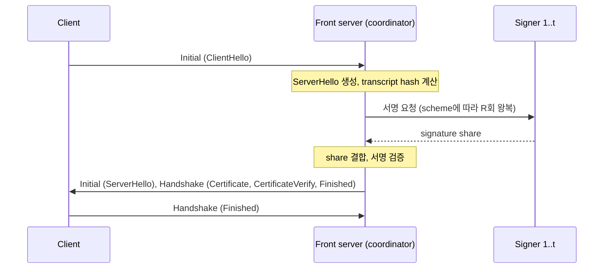

# 문제 정의

대괄호 번호는 [related-work.md](related-work.md)의 참고문헌 번호다.

## 1. 배경

QUIC은 TLS 1.3 handshake를 전송 계층 handshake와 합쳐 1-RTT 안에 연결을 수립한다[1][2]. 서버는 ServerHello를 Initial packet으로, EncryptedExtensions·Certificate·CertificateVerify·Finished를 Handshake packet으로 보낸다. CertificateVerify에는 그 시점까지의 handshake transcript hash에 인증서 개인키로 만든 서명이 들어간다[4]. 서명 대상에 ClientHello가 포함되므로 서버는 ClientHello를 받기 전에 서명을 미리 만들어 둘 수 없다.

서명 키를 보호하는 기존 방법은 세 가지다.

| 방법 | 키의 위치 | handshake 중 추가 지연 | 한계 |
| --- | --- | --- | --- |
| 종단 서버에 키 보관 | QUIC을 종단하는 모든 서버 | 없음 | 서버 하나가 침해되면 키가 유출된다. |
| 원격 key server(Keyless SSL)[7] | key server 한 곳 | 종단 서버와 key server 사이 왕복 1회 | key server가 단일 침해 지점이자 단일 장애 지점이다. |
| Delegated Credentials[5] | 종단 서버에 단기 위임 키 | 없음 | 위임 키가 유효한 기간에는 종단 서버 침해가 곧 위조로 이어진다. |

threshold signature는 키를 n개의 share로 나누고 t개 이상의 share 보유자가 협력해야 서명이 만들어지게 한다. 2023년 NIST MPTS workshop에서 Cloudflare는 edge server에 key share만 두는 방식을 Threshold TLS라고 부르고, 빠른 online 서명, online round trip 수 최소화, 키와 메시지에 무관한 precomputation을 요구사항으로 제시했다[9].

## 2. 시스템 모델

이 문서에서 쓰는 용어는 다음과 같다.

| 용어 | 정의 |
| --- | --- |
| front server | client의 QUIC 연결을 종단하는 서버다. 서명이 필요하면 coordinator 역할을 맡아 signer에게 요청을 보내고 응답을 결합한다. |
| signer(하위 서버) | key share 하나를 보유하고 부분 서명을 계산하는 서버다. 주제 원문의 "하위 서버"에 해당한다. |
| n | key share를 가진 signer의 수다. |
| t | 유효한 서명을 만드는 데 필요한 최소 signer 수다. |
| R | client의 ClientHello를 받은 뒤 coordinator와 signer 사이에 필요한 왕복 횟수다. |
| D_sign | front server가 서명을 요청한 시각부터 완성된 서명을 받은 시각까지의 시간이다. |
| RTT_c | client와 front server 사이의 왕복 시간이다. |
| RTT_s | front server와 각 signer 사이의 왕복 시간이다. |
| T_hs | client가 첫 Initial packet을 보낸 시각부터 client 쪽 handshake가 complete 상태가 된 시각까지의 시간이다. handshake complete의 정의는 RFC 9001 4.1.1절을 따른다[2]. |

front server가 signer 중 하나를 겸하면 원격 호출 대상은 t-1개로 줄어든다. 서명을 기다리는 동안 front server가 ServerHello나 ACK를 먼저 보내는지는 구현체에 따라 다르며, RQ1에서 확인할 대상이다.

## 3. 위협 모델

공격자는 signer를 최대 t-1개까지 침해해 그 서버의 메모리와 key share를 읽는다. 이 공격자는 서명 키를 복원할 수 없어야 하고, 정상 signer의 협력 없이 서명을 만들 수 없어야 한다.

보안 수준은 두 값으로 나타낸다. 첫째는 t다. 둘째는 t개의 signer가 걸쳐 있는 failure domain의 수다. failure domain은 한 번의 침해나 장애가 함께 영향을 주는 단위이며, 이 연구에서는 host, region, 운영 주체 세 단계로 구분한다. 같은 host에 있는 signer 세 개는 t가 3이어도 host 하나의 침해로 무너진다.

가용성은 n-t개의 signer가 응답하지 않아도 서명이 완성된다는 조건으로 정의한다. t를 키우면 공격자가 침해해야 할 서버가 늘어나는 대신, 응답을 기다려야 하는 signer가 늘고 허용되는 장애 수가 줄어든다.

다음 항목은 threshold signature가 막지 못하므로 이 연구의 보안 주장에서 제외한다.

- front server를 침해한 공격자는 침해가 유지되는 동안 임의의 transcript에 대한 서명을 요청할 수 있다. 키는 유출되지 않으므로 침해가 끝나면 위조도 끝난다.
- key share를 처음 만드는 과정(trusted dealer 또는 distributed key generation)에 대한 공격은 다루지 않는다. 초기 실험은 trusted dealer를 가정한다.
- side channel 공격과 threshold signature protocol 자체의 안전성 증명은 다루지 않는다.

## 4. signature scheme 제약

TLS 1.3 client는 표준 SignatureScheme으로 서명을 검증한다. threshold 방식은 표준 검증기가 그대로 받아들이는 서명을 만들어야 하므로 선택지가 제한된다.

| TLS 1.3 SignatureScheme | threshold 방식 | ClientHello 이후 왕복 | precomputation | 공개 WebPKI 인증서 |
| --- | --- | --- | --- | --- |
| ed25519 | FROST(Ed25519, SHA-512)[6][10] | 2회다. nonce commitment를 미리 모아 두면 1회다. | 메시지와 무관한 nonce commitment를 미리 만든다. | 발급되지 않는다. |
| ecdsa_secp256r1_sha256 | threshold ECDSA(DKLs23[13], CGGMP21[12]) | DKLs23은 3 round다. CGGMP21은 presignature가 있으면 online 단계가 non-interactive다. | presignature를 미리 만든다. | 발급된다. |
| rsa_pss_rsae_sha256 | Shoup threshold RSA[11] | 1회다. | 미리 계산할 수 있는 값이 거의 없다[9]. | 발급된다. |

표의 각 항목에는 다음 조건이 붙는다.

- FROST가 만드는 서명 중 Ed25519와 Ed448 ciphersuite의 서명만 RFC 8032 검증기로 검증된다[6]. FROST(P-256, SHA-256)의 결과는 Schnorr 서명이어서 TLS의 ECDSA 검증을 통과하지 못한다.
- CA/Browser Forum Baseline Requirements 6.1.5절은 RSA와 NIST P-256·P-384·P-521 키만 허용한다[19]. Ed25519 인증서는 사설 PKI에서만 쓸 수 있으므로, FROST 구성의 결과는 사설 PKI 환경에 한정된다.
- FROST의 signature share는 round 2에 참여하는 signer 집합의 commitment 목록에 묶여 있다[6]. 따라서 n개 전체에 요청을 보내고 먼저 도착한 t개를 쓰는 방식은 그대로 적용되지 않으며, signer 집합을 먼저 고르거나 서로 다른 집합으로 여러 세션을 동시에 진행해야 한다. FROST는 robustness를 제공하지 않아 참여자 하나가 응답하지 않으면 그 세션은 실패한다. ROAST는 이 문제를 다루는 wrapper protocol이다[14]. 이 연구는 서로 다른 signer 집합의 세션을 동시에 진행하는 hedge 정책을 구현해 측정했다([results-phase3-hedging.md](results-phase3-hedging.md), [results-phase3-adaptive.md](results-phase3-adaptive.md)).
- Shoup threshold RSA의 signature share는 signer마다 독립적으로 계산되므로, n개 전체에 요청하고 먼저 도착한 유효한 share t개를 결합할 수 있다[11].
- nonce commitment와 presignature는 한 번만 써야 한다. 같은 값을 두 서명에 쓰면 서명 키가 드러난다. precomputation을 쓰는 구성은 미리 만든 값의 사용 여부를 signer가 장애 후에도 잃지 않도록 관리해야 하며, 이 관리 비용도 측정 대상에 넣는다.

## 5. 연구 질문과 가설

각 가설에는 예측과 그 예측을 가르는 최소 실험을 붙였다. 실험의 세부 조건은 [experiment-design.md](experiment-design.md)에 있다.

### RQ1. 구현체의 서명 hook과 대기 중 동작

서명 hook은 비동기형과 동기형으로 나뉜다. 비동기형은 서명이 끝나지 않았음을 알리고 handshake를 나중에 재개하며, 동기형은 서명이 끝날 때까지 호출이 반환되지 않는다. source 조사에서 quicly, mvfst, s2n-quic, Cloudflare quiche, BoringSSL을 쓰는 ngtcp2는 QUIC 계층까지 비동기 서명을 지원했고, quic-go, quinn, aioquic, nginx를 포함한 나머지 구현체는 동기 서명만 가능했다(조사표는 [related-work.md](related-work.md) 5절). 동기형 구현체는 실행 모델이 서로 다르다. quic-go는 연결마다 별도 goroutine에서 handshake를 처리하고, aioquic은 asyncio event loop 하나에서 모든 연결을 처리한다.

- 가설 H1: 동기형 hook을 쓰는 구현체에서는 서명 호출이 그 구현체의 실행 단위(thread, event loop, task)를 D_sign 동안 점유한다. 실행 단위 하나가 여러 연결을 처리하는 구현체에서는 동시에 진행되는 다른 handshake의 T_hs도 함께 늘어난다.
- 예측: 동시 handshake 수를 늘리면 비동기형 hook 구현체의 T_hs 중앙값은 유지되고, 실행 단위를 공유하는 동기형 hook 구현체의 T_hs 중앙값은 동시 handshake 수에 비례해 증가한다.
- 최소 실험: 서명 hook에 고정 지연 50 ms를 넣고 동시 handshake 수 1, 10, 100에서 T_hs 분포를 비교한다.
- 판정: pilot 측정에서 예측대로였다([results-phase1-pilot.md](results-phase1-pilot.md) 5절).

### RQ2. 서명 지연의 분해

- 가설 H2: signer 사이의 RTT가 1 ms 미만이면 D_sign은 signer의 계산 시간에 좌우되고, RTT가 수십 ms 이상이면 왕복 횟수 R에 좌우된다.
- 예측: RTT_s를 0.2 ms에서 50 ms로 올리면 D_sign의 증가량은 R × 50 ms에 가깝다. 같은 조건에서 precomputation을 켠 FROST의 증가량은 켜지 않은 FROST의 절반에 가깝다.
- 최소 실험: FROST(precomputation 유무)와 Shoup threshold RSA에 대해 RTT_s 두 수준에서 D_sign을 단계별 timestamp로 분해한다.
- 판정: 예측은 맞았다. RTT_s를 0 ms에서 50 ms로 올렸을 때 D_sign 중앙값의 증가량은 FROST (2, 3)에서 100.1 ms, precomputation을 켠 FROST (2, 3)에서 50.0 ms, threshold RSA (2, 3)에서 50.9 ms였다. 가설의 앞부분은 scheme에 따라 달랐다. RTT_s 0 ms에서 signer 계산이 D_sign 중앙값에서 차지한 비율은 threshold RSA에서 93~95%였고 FROST에서는 절반에 못 미쳤다([results-phase2-signer.md](results-phase2-signer.md) 3절).

### RQ3. 서명 지연이 handshake 시간으로 전달되는 방식

RFC 9002는 RTT sample이 없을 때 초기 RTT를 333 ms로 둘 것을 권고하며, 이 값을 쓰는 client의 첫 PTO는 약 1초다[3]. RTT sample을 하나 얻으면 Initial·Handshake packet number space의 PTO는 약 3 × RTT_c가 된다[3]. front server가 서명을 기다리는 동안 ServerHello나 ACK를 먼저 보내면 client는 RTT sample을 얻고 PTO가 짧아진다.

- 가설 H3: D_sign이 client의 PTO보다 짧으면 T_hs는 서명 지연이 없을 때의 값에 D_sign을 더한 값과 같다. D_sign이 PTO보다 길면 client가 probe packet을 보내고, 구현체에 따라 서버의 재전송이나 추가 대기가 생겨 T_hs의 증가량이 D_sign과 달라진다.
- 예측: RTT_c가 20 ms일 때, ServerHello나 ACK를 먼저 보내는 구현체에서는 D_sign이 약 60 ms를 넘는 지점부터 client probe packet이 관측된다. 먼저 보내지 않는 구현체에서는 D_sign이 약 1초를 넘는 지점부터 관측된다.
- 최소 실험: 서명 hook에 넣는 지연을 0 ms에서 1,200 ms까지 바꾸면서 T_hs와 client·server의 재전송 packet 수를 qlog로 기록한다.
- 판정: pilot 측정에서 T_hs의 증가량은 D_sign이 PTO보다 긴 조건에서도 D_sign과 1 ms 안에서 같았다. probe packet은 관측됐으나 "T_hs의 증가량이 D_sign과 달라진다"는 부분은 기각한다. probe가 시작되는 지연은 client 구현체의 초기 RTT에 따라 달랐다([results-phase1-pilot.md](results-phase1-pilot.md) 4절, 7절).

instant ACK이 조건에 따라 불필요한 재전송이나 더 긴 대기를 만든다는 측정 결과가 이미 있다[16]. 인증서 chain이 anti-amplification limit을 넘으면 round trip이 추가된다는 결과도 있다[15]. 이 연구는 두 효과가 서명 지연과 겹칠 때의 동작을 본다.

### RQ4. 최적 구성

- 가설 H4: t의 하한과 failure domain 수의 하한이 주어지면, T_hs의 p99를 최소화하는 구성은 signer 배치와 signer 선택 정책으로 결정되며, signer별 응답 시간 분포의 order statistic으로 만든 모델이 실측 순위를 재현한다.
- 예측: 모델이 예측한 상위 3개 구성 안에 실측 p99가 가장 낮은 구성이 들어간다.
- 최소 실험: signer 5개를 RTT_s가 서로 다른 세 region에 배치하고, t가 2와 3일 때 가능한 signer 선택 정책을 전수 측정해 모델 예측과 비교한다.
- 중간 결과: signer 5개의 RTT_s를 서로 다르게 둔 한 가지 배치에서 D_sign을 측정했고 예측과 어긋나지 않았다. loss가 있을 때의 순위는 loss를 넣지 않은 모델로 설명되지 않았다. 판정은 Phase 3으로 미룬다([results-phase2-signer.md](results-phase2-signer.md) 5절, 6절).

## 6. 범위

다루는 것은 다음과 같다.

- 서버 인증만 하는 QUIC v1 handshake의 전체 handshake(full handshake)
- emulation 테스트베드와 사설 PKI에서의 측정
- 공개된 threshold signature 구현을 signer 서비스로 묶는 작업

다루지 않는 것은 다음과 같다.

- 새로운 threshold signature protocol의 설계와 안전성 증명
- session resumption과 0-RTT handshake. 이 경우 서버는 CertificateVerify 서명을 하지 않는다. 전체 handshake의 비율은 최적화 결과를 해석할 때 가중치로만 쓴다.
- client 인증(mutual TLS)
- ML-DSA 같은 post-quantum 서명의 threshold 방식[20]
- 실제 서비스 트래픽을 대상으로 한 측정

## 7. 미결정 사항

| 항목 | 현재 가정 | 결정이 바꾸는 것 |
| --- | --- | --- |
| "하위 서버 간 핸드셰이크 지연시간"의 해석 | signer들이 서명에 협력하느라 생기는 지연이 client가 관측하는 QUIC handshake 시간에 주는 영향으로 해석했다. coordinator와 signer 사이 연결을 맺는 비용은 "signer 간 transport" 변인으로 포함했다. | signer끼리 맺는 handshake 자체가 주 측정 대상이라면 T_hs의 정의와 RQ3이 바뀐다. |
| 산출물의 형태와 마감 | 정해지지 않았다. | 구현체 수와 실험 격자의 크기를 정한다. |
| 초기 구현체 | 서버는 비동기형 Cloudflare quiche·s2n-quic과 동기형 quic-go·aioquic을 쓴다. s2n-quic은 아직 측정하지 않았다. | RQ1과 RQ3의 비교 폭을 정한다. |
| signature scheme의 우선순위 | FROST와 Shoup threshold RSA를 구현해 측정했다. threshold ECDSA는 아직 구현하지 않았다. | 공개 WebPKI에 적용 가능한 scheme이 threshold RSA 하나로 남는지가 달라진다. |
| hedge 구성의 안전성 | FROST가 동시 세션에서 안전하다는 성질에 기대며, 따로 검토받지 않았다. | 결과를 실제 배치에 대한 권고로 쓸 수 있는지가 달라진다. |
| coordinator와 signer 사이 연결 | TLS 없는 TCP로 측정했다. signer당 연결 여러 개와 ping nudge를 기본 구성으로 정했다([results-phase3-connections.md](results-phase3-connections.md)). | TLS를 쓸 때의 연결 수립·유지 비용이 달라진다. QUIC 연결 하나로 같은 결과를 얻는지가 다음 확인 대상이다. |
