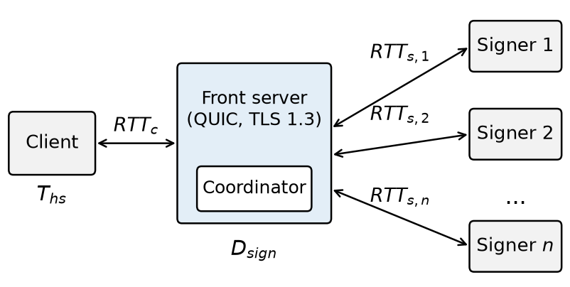
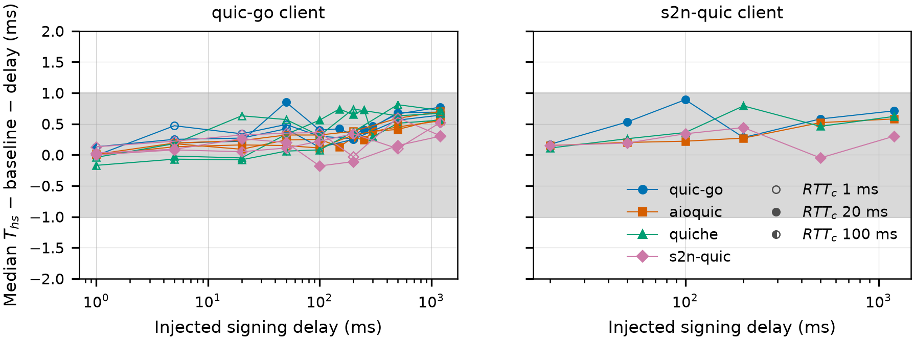
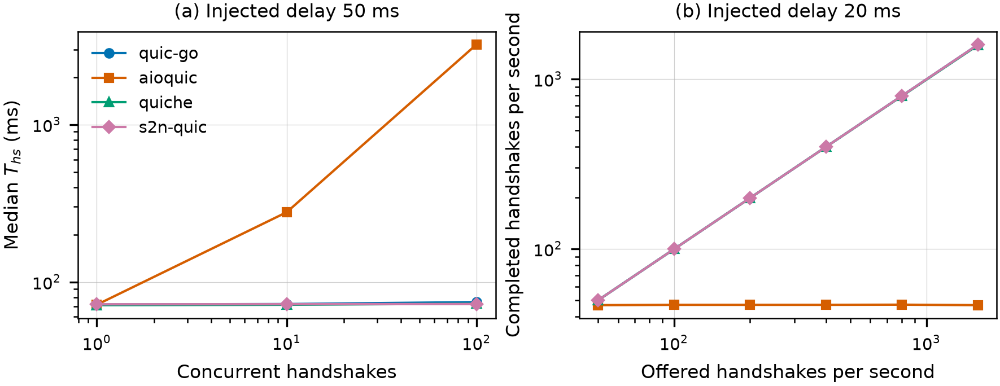
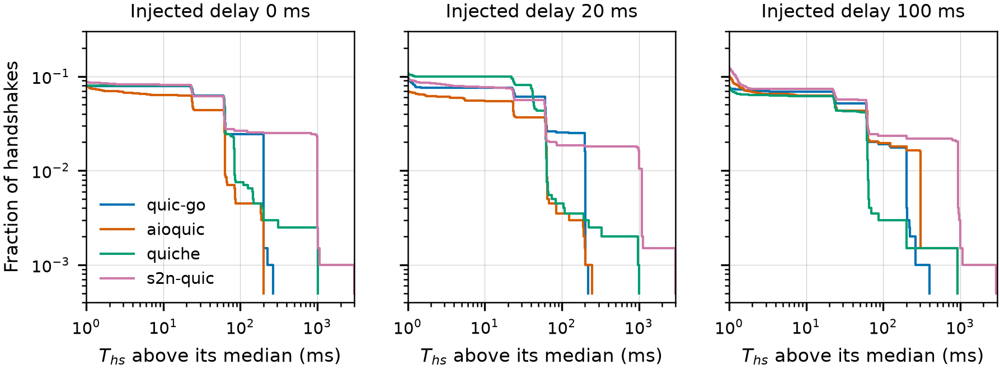
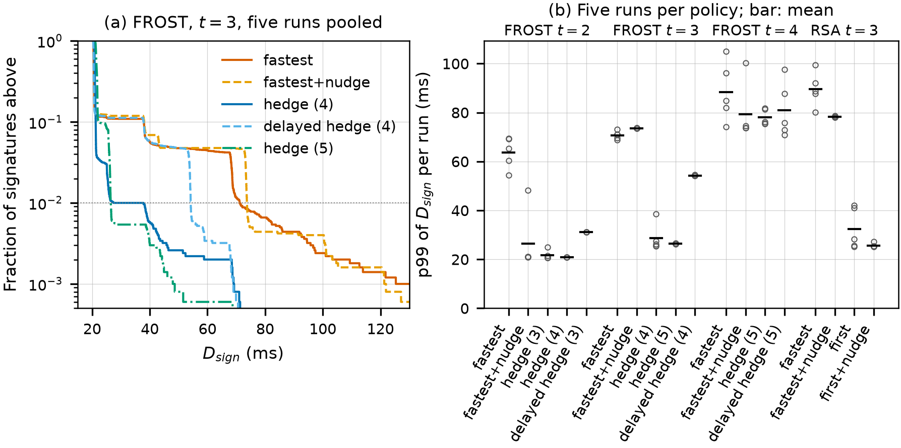
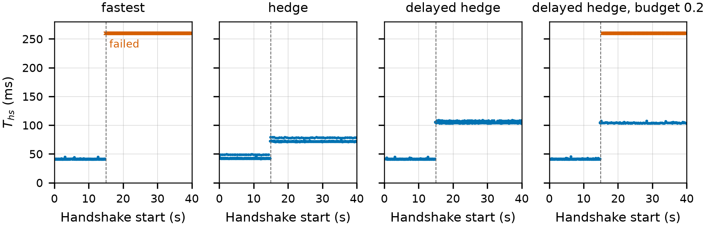

# 임계 서명 기반 키 분산이 QUIC 핸드셰이크 지연에 미치는 영향 분석

(Analysis of the Impact of Threshold-Signature-Based Key Splitting on QUIC Handshake Latency)

# 요약

QUIC 서버는 핸드셰이크마다 인증서 개인키로 서명하므로, 개인키를 보관한 서버 한 대가 침해되면 키가 유출된다. 임계 서명(threshold signature)은 개인키를 여러 서명 서버에 나누어 이 위험을 줄인다. 그러나 서버는 핸드셰이크 도중에 서명 서버와 메시지를 주고받아야 하며, 이로 인한 서명 지연이 QUIC 구현체와 네트워크 환경에 따라 핸드셰이크 시간에 어떻게 반영되는지에 대한 정량적 분석은 부족하다. 본 논문에서는 QUIC 서버 구현체 4종, 클라이언트 구현체 2종, 임계 서명 방식 3종을 대상으로 서명 지연과 핸드셰이크 시간의 관계를 측정하고, 서명 서버의 배치와 선택 정책에 따른 꼬리 지연을 분석한다. 측정 결과, 핸드셰이크를 하나씩 수행할 때 핸드셰이크 시간의 중앙값은 126개 조건 모두에서 서명 지연만큼만 증가하였으며(오차 1ms 이내), 구현체 간 차이는 핸드셰이크가 겹치거나 클라이언트 링크에 손실이 있을 때 나타났다. 서명 서버 5대 중 3대가 협력하는 3개 리전 구성에서 서명 서버 링크의 손실률이 2%일 때, 서명 지연의 99번째 백분위수는 가장 가까운 3대만 쓰면 70.7ms, 여유 서명 서버에도 요청하는 헤지 정책을 쓰면 26.5ms였다.

**키워드**: QUIC, 임계 서명, 핸드셰이크 지연, 키 분산, 꼬리 지연, TLS 1.3

# Abstract

A QUIC server signs every handshake with its certificate private key, so compromising a single server that holds the key exposes it. Threshold signatures reduce this risk by splitting the key among several signers. However, the server must then exchange messages with the signers during the handshake, and how the resulting signing delay translates into handshake time across QUIC implementations and network conditions has received little quantitative analysis. This paper measures the relation between signing delay and handshake time for four QUIC server implementations, two client implementations, and three threshold signature schemes, and analyzes tail latency under different signer placements and selection policies. When handshakes are performed one at a time, the median handshake time increases by the signing delay alone, to within 1 ms, in all 126 conditions. Differences among implementations appear under concurrent handshakes or loss on the client link. With five signers in three regions, a threshold of three, and 2% loss on the signer links, the 99th percentile of the signing delay is 70.7 ms under a policy that uses only the three nearest signers and 26.5 ms under a hedging policy that also queries the spare signers.

**Keywords**: QUIC, threshold signature, handshake latency, key splitting, tail latency, TLS 1.3

# 1. 서론

QUIC 프로토콜은 전송 계층 연결 수립과 TLS 1.3 핸드셰이크(handshake)를 하나로 묶어 연결 지연을 줄인 전송 프로토콜이다[1,2]. QUIC 서버는 핸드셰이크마다 인증서 개인키로 CertificateVerify 메시지에 서명하여 자신을 인증한다[3]. 이 개인키는 QUIC 연결을 종단하는 서버의 메모리에 있으므로, 콘텐츠 전송망의 에지 서버처럼 여러 곳에 배치된 서버 가운데 한 대만 침해되어도 키가 유출된다.

이러한 위험을 줄이기 위해 서명 연산을 서버 밖으로 옮기는 방법들이 제안되어 왔다. Keyless SSL은 에지 서버가 개인키 없이 핸드셰이크를 진행하고 서명만 원격 키 서버에 맡긴다[4,5]. 임계 서명(threshold signature)은 개인키를 n개의 조각으로 나누어 서로 다른 서명 서버에 두고, t개 이상이 협력해야 서명이 만들어지도록 한다[6-8]. 완전한 키를 가진 서버가 없으므로 공격자는 t대를 침해하여야 키를 얻을 수 있다. 임계 서명을 TLS 서버 인증에 적용하는 방안도 논의되고 있다[9].

그러나 임계 서명을 QUIC 서버에 적용하면 핸드셰이크 도중에 서명 서버와 메시지를 한 번 이상 주고받아야 하며, 이로 인한 서명 지연이 핸드셰이크 시간에 미치는 영향에 대한 분석은 부족하다. QUIC 핸드셰이크에서는 서버가 서명을 기다리는 동안에도 클라이언트의 손실 복구 타이머가 진행되고[10], 주소 검증 전의 서버는 받은 데이터의 3배까지만 보낼 수 있다[1]. 또한 서명을 기다리는 동안 다른 연결을 처리하는지와 클라이언트에 무엇을 먼저 보내는지는 구현체마다 다르다. 기존 연구로는 서버가 인증서를 기다리는 지연이 클라이언트의 타이머에 미치는 영향을 클라이언트 구현체별로 측정한 연구[11]와, TCP 위의 TLS에서 임계 ECDSA를 쓰는 서버의 응답 시간을 측정한 연구[12]가 있다. 이러한 연구들은 클라이언트 구현체의 동작이나 TCP 위 TLS의 응답 시간을 대상으로 하고 있어, 서버 구현체, 서명 방식, 서명 서버의 배치가 함께 바뀔 때의 QUIC 핸드셰이크 지연을 설명하기 어렵다. 따라서 임계 서명의 서명 지연이 QUIC 핸드셰이크 시간으로 전달되는 과정을 구현체와 환경별로 분석할 필요가 있다.

본 논문에서는 임계 서명으로 인증서 개인키를 분산한 QUIC 서버의 핸드셰이크 지연을 측정하고 분석한다. 구체적으로 다음 네 가지를 분석한다. 첫째, 서명을 기다리는 동안의 동작이 QUIC 구현체마다 어떻게 다른지 확인한다. 둘째, 임계 서명의 서명 지연이 서명 방식별로 왕복 횟수, 서명 서버와의 왕복 시간, 계산 시간으로 어떻게 나뉘는지 분석한다. 셋째, 서명 지연이 클라이언트가 관측하는 핸드셰이크 시간에 그대로 더해지는 조건과 그보다 커지는 조건을 구분한다. 넷째, 침해와 장애를 견뎌야 하는 서명 서버 수와 리전(region) 수가 주어졌을 때 서명 지연의 99번째 백분위수가 가장 낮은 서명 서버 배치와 선택 정책을 찾는다. 이를 위해 서버 구현체 4종(quic-go, aioquic, quiche, s2n-quic)과 클라이언트 구현체 2종을 하나의 에뮬레이션 환경에 구성하였다. 임계 서명 방식으로는 FROST, 임계 RSA, 임계 ECDSA를 사용하였고, 서명 서버를 고르는 정책 여섯 가지를 구현하여 비교하였다.

측정 결과, 핸드셰이크를 하나씩 수행할 때 핸드셰이크 시간의 중앙값은 주입한 서명 지연 1~1,200ms의 126개 조건 모두에서 서명 지연만큼만 증가하였다(오차 1ms 이내). 구현체 간 차이는 두 조건에서 나타났다. 핸드셰이크 100개가 동시에 시작되면(서명 지연 50ms) 하나의 이벤트 루프에서 서명을 기다리는 aioquic의 핸드셰이크 시간 중앙값이 다른 구현체의 40배 이상으로 늘었다. 클라이언트 링크에 손실이 있으면 손실을 겪은 핸드셰이크가 추가로 지연되는 시간이 서버 구현체에 따라 약 60ms, 200ms, 1초로 달랐다. 서명 서버 5대를 3개 리전에 두고 3대가 협력해야 하는 구성에서는 서명 서버 링크의 손실률을 2%로 두고 선택 정책을 비교하였다. 서명 지연의 99번째 백분위수는 가장 가까운 서버만 쓰는 정책에서 70.7ms, 여유 서명 서버에 함께 요청하는 헤지 정책에서 26.5ms였다. 또한 별도의 장애 측정에서 선택된 서명 서버 하나가 응답을 멈추면, 이후에 시작한 핸드셰이크는 가장 가까운 서버만 쓰는 정책에서 모두 실패하였고 헤지 정책에서 모두 성공하였다.

# 2. 배경 및 관련 연구

## 2.1 QUIC 핸드셰이크와 서명 대기

QUIC 핸드셰이크에서 서버는 ClientHello를 받은 뒤 ServerHello, 인증서, CertificateVerify, Finished를 보낸다[2,3]. CertificateVerify는 그때까지의 핸드셰이크 기록에 대한 서명이므로 핸드셰이크가 시작된 뒤에만 계산할 수 있다. 서버가 서명을 기다리는 동안 클라이언트는 손실 복구 타이머에 따라 동작한다. RFC 9002는 왕복 시간(Round-Trip Time, RTT) 표본이 없을 때 초깃값을 333ms로 둘 것을 권고하며, 이 경우 첫 탐침 타임아웃(Probe Timeout, PTO)은 약 1초이다[10]. RTT 표본을 하나 얻으면 PTO는 RTT의 약 3배가 된다. 또한 서버는 클라이언트의 주소를 검증하기 전까지 받은 데이터의 3배까지만 보낼 수 있으며, 이를 증폭 방지 제한(anti-amplification limit)이라 한다[1].

서명을 TLS 라이브러리 밖으로 넘기는 인터페이스(이하 서명 훅)는 두 가지로 나뉜다. 비동기형 훅은 서명이 진행 중임을 알리고 핸드셰이크를 나중에 재개하며, BoringSSL의 개인키 메서드[13]와 s2n-tls의 개인키 연산 오프로드[14]가 이에 해당한다. 동기형 훅은 서명이 끝난 뒤에 호출이 반환되며, Go 표준 라이브러리의 crypto/tls[15]와 rustls[16]가 이에 해당한다. 본 연구는 두 종류의 훅을 쓰는 서버 구현체를 함께 측정하여, 서명 대기가 핸드셰이크 시간에 미치는 영향이 훅의 종류와 실행 구조에 따라 어떻게 달라지는지 비교한다.

## 2.2 키 보호와 원격 서명

연결을 종단하는 서버에서 인증서 개인키를 분리하는 방식들이 제안되어 왔다. Keyless SSL은 서명 연산을 원격 키 서버에 맡기는 방식이며, Stebila와 Sullivan[4]은 이 방식의 보안과 성능을 분석하였다. Bhargavan 등[5]은 Keyless SSL의 암호학적 안전성을 분석하였다. Delegated Credentials[17]는 인증서 소유자가 유효 기간이 짧은 위임 키를 발급하여 에지 서버가 위임 키로 서명하게 한다. LURK-T[18]는 TLS 1.3 서버를 핸드셰이크 엔진과 신뢰 실행 환경 안의 암호 서비스로 나누었다. 그러나 이러한 방식들에서는 완전한 개인키가 키 서버, 인증서 소유자, 신뢰 실행 환경 가운데 한 곳에 그대로 있으므로, 그곳이 침해되면 키가 유출된다는 한계가 있다.

임계 서명을 TLS 서버 인증에 쓰는 방안도 제시되었다. Faz-Hernández[9]는 TLS에 임계 서명을 적용하기 위한 요구 사항으로 빠른 온라인 서명과 왕복 횟수의 최소화를 들고, 임계 RSA와 FROST의 계산 시간을 제시하였다. Kolegov 등[12]은 Keyless SSL의 대안으로 임계 ECDSA를 쓰는 TLS를 제안하고, TCP 위의 TLS에서 동시 요청 수에 따른 서버의 평균 응답 시간을 측정하였다. 그러나 이러한 연구들은 측정 범위가 계산 시간이나 단일 서버의 응답 시간에 국한되어 있으며, 서명 서버와의 왕복 시간과 손실, QUIC 구현체의 차이는 다루지 않았다.

## 2.3 임계 서명

임계 서명은 n개의 서명 서버 가운데 t개 이상이 협력해야 유효한 서명이 만들어지는 서명 방식이다. TLS 클라이언트는 표준 서명 알고리즘으로 서명을 검증하므로, 표준 검증기가 그대로 받아들이는 서명을 만드는 방식만 쓸 수 있다. FROST[7,8]는 Schnorr 계열의 임계 서명으로 두 번의 왕복이 필요하며, 메시지와 무관한 값을 미리 교환해 두면 한 번으로 줄어든다. FROST가 만드는 Ed25519 서명은 표준 검증기로 검증되지만, 공개 웹 인증서는 RSA와 NIST 타원곡선 키만 허용하므로[19] FROST의 적용 범위는 사설 인증 체계로 한정된다. Shoup의 임계 RSA[6]는 서명 서버마다 부분 서명(signature share)을 독립적으로 계산하므로 한 번의 왕복으로 끝난다. 임계 ECDSA는 서명 서버 사이의 상호 작용이 많으며, GG20[20], CGGMP21[21], DKLs23[22]과 같은 프로토콜이 제안되었다.

서명 서버 하나가 응답을 멈출 때의 동작도 방식마다 다르다. 임계 RSA는 n개 모두에 요청하고 먼저 도착한 t개의 부분 서명을 결합할 수 있다. FROST의 부분 서명은 서명에 참여하는 서명 서버 집합에 묶여 있어, 집합 안의 한 서버라도 응답하지 않으면 해당 집합으로 진행한 서명(이하 세션)은 실패한다. ROAST[23]는 여러 세션을 동시에 진행하여 이 문제를 다룬다. 응답이 늦은 요청에 대비해 같은 요청을 여러 서버에 보내는 헤지 요청(hedged request)은 대규모 서비스의 꼬리 지연(tail latency)을 줄이는 기법으로 알려져 있다[24]. 본 연구는 서로 다른 서명 서버 집합의 세션을 동시에 진행하는 방식과 헤지 요청을 서명 서버 선택 정책으로 구현하여(3.4절), 서명 서버 링크에 손실이나 장애가 있을 때의 효과를 측정한다.

## 2.4 QUIC 핸드셰이크 성능 측정

QUIC 핸드셰이크의 지연을 구현체별로 측정하는 연구가 진행되어 왔다. Nawrocki 등[25]은 인증서 체인의 크기가 증폭 방지 제한을 넘으면 왕복이 추가됨을 보였다. Mücke 등[11]은 서버가 인증서를 기다리는 동안 확인 응답을 먼저 보내는 방식의 효과를 클라이언트 구현체 8종으로 측정하고, 대기 지연이 클라이언트의 RTT 추정과 PTO를 늘린다고 보고하였다. 두 연구 모두 QUIC Interop Runner[26]를 사용하였다. 핸드셰이크의 인증 단계가 느려지거나 커질 때의 영향은 양자 내성 서명에 대해서도 측정되었다[27,28].

본 연구는 서버가 핸드셰이크 도중에 외부의 응답을 기다린다는 점은 Mücke 등[11]과 동일하나, 다음 세 가지 점에서 차별화된다. 첫째, 클라이언트가 아니라 서버 구현체의 서명 훅과 실행 구조를 비교한다. 둘째, 지연을 주입하는 데 그치지 않고 실제 임계 서명 서버를 연결하여 서명 지연을 분해한다. 셋째, 서명 서버의 배치, 선택 정책, 장애에 따른 꼬리 지연을 다룬다. 임계 서명의 지연을 QUIC 핸드셰이크 안에서 구현체별로 측정한 연구는 본 연구가 조사한 범위에서 확인되지 않았다.

# 3. 측정 설계

## 3.1 시스템 모델과 지표

그림 1은 측정 대상 시스템의 구조를 보여준다. 시스템은 클라이언트, 전면 서버(front server), 조정자(coordinator), n개의 서명 서버(signer)로 구성된다. 전면 서버는 QUIC 연결을 종단하고, 핸드셰이크마다 조정자에 서명을 요청한다. 조정자는 서명 서버들에 요청을 보내고 부분 서명을 모아 하나의 서명으로 결합한다. 각 서명 서버는 개인키의 조각 하나를 가지며, 완전한 키는 어느 구성 요소에도 존재하지 않는다.

그림 1 측정 대상 시스템의 구조

Fig. 1 Structure of the measured system

지표는 두 가지로 정의한다. 핸드셰이크 시간 $T_{hs}$는 클라이언트가 연결을 시작한 시각부터 클라이언트에서 핸드셰이크가 완료된 시각까지의 시간이다. 서명 지연 $D_{sign}$은 전면 서버가 서명을 요청한 시각부터 완성된 서명을 받은 시각까지의 시간이다. 클라이언트와 전면 서버 사이의 왕복 시간은 $RTT_c$, 조정자와 서명 서버 사이의 왕복 시간은 $RTT_s$로 표기한다. 두 지표는 중앙값과 99번째 백분위수(이하 p99)로 보고하며, 꼬리 지연은 p99와 기준 시간을 넘겨 지연된 핸드셰이크 또는 서명의 비율로 나타낸다. $D_{sign}$은 조정자와 서명 서버 사이의 왕복 횟수, 왕복 시간, 서명 서버의 계산 시간으로 나누어 분석한다.

공격자는 서명 서버를 최대 t−1대까지 침해할 수 있다고 가정한다. 서명 서버가 여러 리전에 나뉘어 있을 때는 두 가지 성질을 구분한다. 리전 안전성은 모든 리전에서 서명 서버 수가 t보다 적어, 어느 리전 하나의 서명 서버가 모두 침해되어도 키가 보호되는 성질이다. 리전 장애 허용은 서명 서버가 가장 많은 리전 전체에 장애가 발생하여도 t대가 남아 서명할 수 있는 성질이다.

## 3.2 측정 환경

측정은 리눅스 호스트 한 대에서 수행하였다. 호스트의 CPU는 AMD Ryzen 7 9700X(8코어 16스레드), 메모리는 30GB이며, 운영체제로는 Ubuntu 24.04를 사용하였다. 클라이언트, 전면 서버, 서명 서버는 각각 Docker 컨테이너로 실행되며 측정 전용 브리지 네트워크에 연결된다. 조정자는 전면 서버와 같은 컨테이너에서 실행된다(3.3절). 링크의 지연과 손실은 각 컨테이너의 네트워크 인터페이스에 tc netem을 적용하여 만든다. 지연은 양쪽 송신 방향에 RTT의 절반씩 주고, 손실은 방향마다 같은 비율로 독립적으로 준다. 전면 서버와 클라이언트에는 논리 CPU를 기본으로 2개씩, 서명 서버에는 1개씩 고정하여 할당한다. 동시 핸드셰이크 측정에서는 클라이언트에, 서명 서버의 처리율 측정에서는 전면 서버에 논리 CPU 4개를 할당하였다.

구현체 간 비교의 공정성을 확보하기 위해 다음 조건을 동일하게 맞추었다. QUIC 버전은 v1이고, 주소 검증용 Retry와 세션 재개는 사용하지 않는다. 인증서 체인은 서버의 첫 응답이 증폭 방지 제한 안에 들어가는 크기로 고정한다. 키 교환 그룹은 X25519MLKEM768로 맞추며, s2n-quic 서버가 s2n-tls를 쓰는 조건(인증서 키가 RSA 또는 P-256인 경우)에서만 X25519를 사용한다.

## 3.3 구현체와 서명 방식

표 1은 측정한 QUIC 구현체를 정리한 것이다. 서버 구현체는 서명 훅의 종류와 실행 구조가 서로 다른 4종을 선택하였다. quic-go는 동기형 훅을 쓰지만 연결마다 별도의 고루틴에서 핸드셰이크를 처리한다. aioquic은 동기형 훅을 쓰며 하나의 이벤트 루프가 모든 연결을 처리한다. quiche는 비동기형 훅을 쓴다. s2n-quic은 인증서 키가 RSA나 P-256이면 s2n-tls의 비동기형 훅을 쓰고, s2n-tls가 지원하지 않는 Ed25519이면 rustls의 동기형 훅을 핸드셰이크마다 별도 스레드에서 호출한다. 서명을 기다리는 동안 서버가 클라이언트에 먼저 보내는 패킷도 구현체마다 다르며, 이는 4.3절에서 클라이언트의 패킷 기록으로 확인한다. 클라이언트로는 quic-go와 s2n-quic을 사용한다.

표 1 측정한 QUIC 구현체와 서명 훅

Table 1 Measured QUIC implementations and signing hooks

| 역할 | 구현체(버전) | TLS 라이브러리 | 서명 훅 | 실행 구조 |
| --- | --- | --- | --- | --- |
| 서버, 클라이언트 | quic-go(0.65.0) | Go crypto/tls | 동기형 | 연결마다 고루틴 |
| 서버 | aioquic(1.8.0) | 자체 구현 | 동기형 | 이벤트 루프 1개 |
| 서버 | quiche(0.30.1) | BoringSSL | 비동기형 | 이벤트 루프 1개 |
| 서버, 클라이언트 | s2n-quic(1.92.0) | s2n-tls 또는 rustls | 비동기형(s2n-tls), 동기형(rustls) | 다중 스레드 |

측정에서 서명 지연은 지연 주입과 실제 서명의 두 가지 방식으로 만든다. 지연 주입 방식에서는 서버가 자신의 키로 서명하기 전에 정해진 시간만큼 기다린다. 이 방식은 서명 지연의 크기만 바꾸면서 구현체의 동작을 비교하는 데 쓴다. 실제 서명 방식에서는 조정자가 서명 서버들과 임계 서명 프로토콜을 수행한다.

임계 서명 방식으로는 FROST(Ed25519), Shoup의 임계 RSA(2,048비트), 임계 ECDSA(P-256, GG20)를 사용한다. FROST와 임계 ECDSA는 메시지와 무관한 단계를 미리 수행해 두는 사전 계산(precomputation)의 유무를 나누어 측정한다. 키 조각은 신뢰할 수 있는 분배자가 나눈다. (t, n)은 (2, 3)과 (3, 5)를 기본으로 하고, 비교 기준으로 원격 서명 서버 하나가 키 전체를 갖는 (1, 1)을 둔다. 조정자와 서명 서버 사이의 연결로는 서명 서버마다 유지되는 QUIC 연결 4개를 사용한다.

조정자는 quic-go 서버에서는 서버 프로세스 안에 두고, 나머지 서버에서는 같은 컨테이너의 별도 프로세스로 실행한다. 후자의 경우 서버는 서명 훅에서 조정자 프로세스에 요청을 보내고 서명을 받는다.

## 3.4 서명 서버 선택 정책

조정자가 서명에 참여할 서명 서버를 고르는 정책은 다음 여섯 가지이다.

1) 고정(fixed) 정책은 번호가 앞선 t개를 항상 사용한다.
2) 최근접(fastest) 정책은 추정한 $RTT_s$가 가장 짧은 t개를 사용한다.
3) 선착(first) 정책은 n개 모두에 요청하고 먼저 도착한 t개의 부분 서명을 결합한다. 이 정책은 부분 서명이 서로 독립인 임계 RSA에 적용한다.
4) 헤지(hedge) 정책은 가까운 m개의 서명 서버에서 고를 수 있는 모든 t개 조합으로 FROST 세션을 동시에 진행하고, 먼저 끝난 세션의 서명을 사용한다. 이하 헤지(m)으로 표기한다.
5) 지연 헤지(delayed hedge) 정책은 최근접 정책으로 시작하고, 예상 응답 시간의 1.5배에 2ms를 더한 시간이 지나도록 서명이 끝나지 않으면 요청 대상을 헤지 정책과 같이 가까운 m개로 넓힌다. 여기서 예상 응답 시간은 왕복 횟수에 최근접 정책이 고른 서명 서버 가운데 가장 먼 서버의 $RTT_s$ 추정값을 곱한 값이다. 이렇게 넓히는 서명의 비율을 제한하는 예산(budget)을 둘 수 있다. 이하 지연 헤지(m)으로 표기한다.
6) 넛지(nudge) 정책은 지연 헤지 정책과 같은 시간이 지나도록 응답하지 않은 서명 서버의 연결에 핑(ping)을 보내 손실된 패킷의 복구를 앞당긴다. 넛지 정책은 서명 서버를 고르지 않는 보조 정책이므로 최근접 정책이나 선착 정책에 더하여 쓴다.

헤지 정책은 서명마다 여러 조합의 부분 서명을 계산하므로 계산량이 늘어난다. 예를 들어, t=3이고 m=4이면 서명 하나에 부분 서명 12개를 계산한다.

## 3.5 측정 절차

측정은 핸드셰이크 또는 서명을 하나씩 순서대로 수행하는 측정, 여러 개를 동시에 시작하는 측정, 정해진 도착률로 시작하는 측정의 세 가지로 구분한다. 한 조건을 한 번 실행한 것을 회차라 하며, 회차당 핸드셰이크 또는 서명의 수는 해당 절에 적었다. 백분위수는 최근접 순위 방식으로 계산한다. 4.1절, 4.2절, 4.4절, 4.6절의 결과와 표 5의 일부 행은 조건마다 한 회차를 측정한 값이다. 꼬리 지연에 관한 주요 결과는 회차를 반복하거나 회차당 표본을 늘린 측정으로 얻었다. 표 4와 4.5절의 핸드셰이크 결과는 같은 조건을 5회 반복 측정한 후 p99의 평균과 95% 신뢰구간(Student-t)을 보고한다. 표 6은 2회를 합친 서명 2,000개의 p99를, 표 2는 핸드셰이크 2,000개 가운데 지연된 핸드셰이크의 비율과 95% 신뢰구간(Wilson)을 보고한다.

측정은 두 시기에 수행하였다. 조건마다 한 번 측정한 결과는 호스트에서 본 측정과 무관한 프로세스가 함께 실행되던 시기에 얻었으며, 측정 전 1분 부하 평균은 1.4~6.7이었다. 반복 측정은 호스트를 다시 시작한 뒤에 수행하였고, 측정 전 1분 부하 평균은 0.0~8.2(중앙값 0.5)였다. 이 가운데 표 4의 3~4회차와 4.5절의 헤지(5) 핸드셰이크 측정 때에는 다른 사용자의 부하가 있었다. 결과와 비교할 예측과 판정 기준은 측정 전에 기록하였고, 결과를 본 뒤에 정한 규칙은 해당 절에 정한 시점을 밝혔다. 측정 코드와 원자료는 공개 저장소(https://github.com/FMsongX2/quic-threshold-handshake)에 있다.

# 4. 측정 결과

## 4.1 서명 지연의 가산성

서명 지연이 핸드셰이크 시간에 전달되는 방식을 확인하기 위해, 지연 주입 방식으로 서명 지연을 1ms에서 1,200ms까지 바꾸면서 핸드셰이크를 하나씩 수행하였다. $RTT_c$는 1, 20, 100ms이고 손실은 없으며, 조건마다 핸드셰이크를 50회 또는 100회 수행하였다. 그림 2는 핸드셰이크 시간의 중앙값에서 지연이 없을 때의 중앙값과 주입한 지연을 뺀 값(이하 초과분)을 보여준다.

그림 2 주입한 서명 지연에 따른 핸드셰이크 시간의 초과분

Fig. 2 Excess handshake time by injected signing delay

그림 2에서 볼 수 있듯이, 서버 구현체 4종과 클라이언트 구현체 2종의 126개 조건(quic-go 클라이언트 102개, $RTT_c$ 20ms의 s2n-quic 클라이언트 24개) 모두에서 초과분은 −0.18~0.89ms였다. 이는 서명 지연이 핸드셰이크 시간에 그대로 더해짐을 보여준다. 서명 지연이 클라이언트의 PTO보다 긴 조건에서는 클라이언트가 탐침 패킷을 보냈으나 초과분은 같은 범위에 머물렀다. 이는 서버가 서명을 마친 뒤 보내는 응답이 탐침과 무관하게 같은 시각에 도착하기 때문이다. 탐침의 비용은 패킷 수로 나타났다. $RTT_c$ 1ms, 지연 1,200ms에서 핸드셰이크 완료까지 클라이언트가 보낸 패킷은 서버 구현체에 따라 평균 5개(s2n-quic)~18개(aioquic)였다.

실제 서명 서버를 연결한 측정에서도 같은 결과를 얻었다. quic-go 서버에 서명 구성 8가지를 연결하고 $RTT_c$와 $RTT_s$를 바꾸어 72개 조건을 조건마다 200회씩 측정하였다. 8가지는 사전 계산 유무와 (2, 3), (3, 5)로 나눈 FROST 4가지, (2, 3)과 (3, 5)의 임계 RSA 2가지, 비교 기준인 (1, 1) 2가지이다. $T_{hs}$의 중앙값에서 $D_{sign}$의 중앙값과 $RTT_c$를 뺀 값은 0.75~1.27ms로, 서명 지연이 없을 때 핸드셰이크 시간이 $RTT_c$를 넘는 크기(quic-go 서버에서 약 1ms)와 같은 수준이었다. 같은 서명 서버를 서버 구현체 4종에 연결하였을 때 $T_{hs}$와 $D_{sign}$의 중앙값 차이는 $RTT_c$ 20ms에서 20.6~21.8ms로, 구현체에 따른 차이가 1.3ms 이내였다. 조정자를 별도 프로세스로 둔 비용은 0.01~0.13ms였다. 이러한 결과는 핸드셰이크가 하나씩 진행되고 손실이 없는 조건에서는 서명 지연만으로 핸드셰이크 시간을 예측할 수 있음을 보여준다.

## 4.2 동시 핸드셰이크와 처리율

구현체의 실행 구조가 핸드셰이크 시간에 미치는 영향을 평가하기 위해, 서명 지연 50ms를 주입하고 핸드셰이크를 1, 10, 100개씩 동시에 시작하였다($RTT_c$ 20ms, quic-go 클라이언트). 그림 3(a)는 핸드셰이크 시간의 중앙값을 보여준다. 동시 100개에서 중앙값은 quic-go 74.4ms, quiche 72.7ms, s2n-quic 72.3ms로, 하나씩 수행할 때와의 차이가 2.7ms 이내였다. 반면, aioquic은 동시 10개에서 277.2ms, 100개에서 3,228ms로 늘었고, 100개 조건에서는 500개 중 4개가 실패하였다. 이는 aioquic의 이벤트 루프가 서명을 기다리는 동안 다른 연결의 처리를 멈추어 서명이 차례로 처리되기 때문이다. quic-go는 동기형 훅을 쓰지만 연결마다 고루틴이 따로 있어 서명 대기가 다른 연결에 영향을 주지 않았다. 실제 서명 서버를 연결한 경우에도 $D_{sign}$이 약 50ms인 조건의 동시 10개에서 aioquic의 $T_{hs}$ 중앙값은 283~290ms였고 나머지 서버는 71~74ms였다.

그림 3 동시 핸드셰이크 수와 도착률에 따른 서버 구현체 비교: (a) 핸드셰이크 시간; (b) 처리율

Fig. 3 Comparison of server implementations by number of concurrent handshakes and arrival rate: (a) handshake time; (b) throughput

그림 3(b)는 핸드셰이크를 정해진 도착률로 10초 동안 시작하였을 때의 처리율(초당 완료된 핸드셰이크 수)을 보여준다. quic-go와 s2n-quic은 서명 지연 0, 5, 20ms 모두에서($RTT_c$ 20ms) 초당 1,600개까지 핸드셰이크 시간의 변화 없이 모두 처리하였고, quiche는 모두 처리하였으나 중앙값이 2.5~3.3ms 늘었다. aioquic의 처리율은 서명 지연 0, 5, 20ms에서 각각 초당 약 640, 157, 47개로 제한되었다. 이는 서명 지연에 핸드셰이크 하나의 처리 시간 약 1.6ms를 더한 값의 역수와 일치한다.

핸드셰이크가 겹칠 때는 서명 서버의 계산 대기도 핸드셰이크 시간을 늘렸다. quic-go 서버에 연결한 임계 RSA (3, 5)에서($RTT_s$ 5ms) $D_{sign}$의 중앙값은 동시 핸드셰이크 1, 10, 100개에서 각각 9.6, 45.1, 375.4ms였다. 이 증가는 quiche와 s2n-quic 서버에서도 나타났으며, 동시 100개에서 $T_{hs}$의 중앙값은 세 구현체에서 0.4~0.6초였다. 이벤트 루프의 대기가 더해지는 aioquic에서는 0.7초 이상이었다. 이러한 증가는 각 서명 서버가 CPU 1개로 부분 서명을 하나씩 계산하여 요청이 대기하기 때문이다.

## 4.3 클라이언트 링크의 손실

클라이언트 링크의 손실이 서명 대기와 겹칠 때의 영향을 평가하기 위해, 클라이언트 링크에 방향별 손실률 2%를 주고 지연 주입 방식으로 핸드셰이크를 하나씩 2,000회 수행하였다. $RTT_c$는 20ms이고 클라이언트는 quic-go이다. 12개 조건 모두에서 2,000회가 전부 성공하였고, 핸드셰이크 시간의 중앙값은 구현체에 따른 차이가 0.9ms 이내였다. 그림 4는 핸드셰이크 시간이 중앙값을 넘은 크기의 분포를 보여주며, 표 2는 중앙값보다 150ms 넘게 지연된 핸드셰이크의 비율과 p99를 정리한 것이다.

그림 4 클라이언트 링크 손실 2%에서 핸드셰이크 시간의 초과분 분포

Fig. 4 Distribution of excess handshake time under 2% loss on the client link

표 2 클라이언트 링크 손실 2%에서 지연된 핸드셰이크의 비율과 p99

Table 2 Fraction of delayed handshakes and p99 under 2% loss on the client link

| 서버 | 지연 0ms: 비율(%) | p99(ms) | 지연 20ms: 비율(%) | p99(ms) | 지연 100ms: 비율(%) | p99(ms) |
| --- | --- | --- | --- | --- | --- | --- |
| quic-go | 2.40 [1.81, 3.17] | 222.3 | 2.45 [1.86, 3.22] | 242.6 | 1.70 [1.22, 2.37] | 322.8 |
| aioquic | 0.40 [0.20, 0.79] | 85.5 | 0.25 [0.11, 0.58] | 106.6 | 1.75 [1.26, 2.42] | 426.4 |
| quiche | 0.40 [0.20, 0.79] | 106.2 | 0.30 [0.14, 0.65] | 105.8 | 0.25 [0.11, 0.58] | 185.3 |
| s2n-quic | 2.50 [1.90, 3.28] | 1,021.0 | 1.80 [1.30, 2.48] | 1,042.5 | 2.30 [1.73, 3.05] | 1,056.1 |

열 머리의 지연은 주입한 서명 지연이고, p99는 핸드셰이크 시간의 p99이다. 비율은 핸드셰이크 시간이 중앙값보다 150ms 넘게 긴 핸드셰이크의 비율이며, 대괄호 안은 95% 신뢰구간(Wilson)이다(조건당 2,000회).

표 2에서 볼 수 있듯이, quic-go와 s2n-quic에서는 모든 조건에서 1.70~2.50%의 핸드셰이크가 150ms 넘게 지연되었고, quiche에서는 0.25~0.40%였다. quic-go와 quiche의 신뢰구간은 세 조건 모두에서 서로 분리되었다. 지연의 크기도 구현체마다 달랐다. quic-go에서는 약 200ms, s2n-quic에서는 약 1초가 더 걸렸으며, s2n-quic에서 지연된 핸드셰이크의 87~97%가 900ms를 넘었다. aioquic에서는 서명 지연이 0, 20ms일 때 0.25~0.40%가 약 200ms 지연되었고, 100ms일 때는 1.75%가 약 300ms 지연되었다. 한편, quiche에서도 0.10~0.20%의 핸드셰이크가 900ms 넘게 지연되었으며, 이 지연의 원인 분석은 향후 과제로 남긴다.

지연의 원인을 확인하기 위해, 같은 조건의 앞선 측정(조건당 400회)에서 지연된 핸드셰이크 가운데 일부의 클라이언트 패킷 기록을 분석하였다. quic-go 서버의 첫 응답이 손실되면 클라이언트는 RTT 표본 없이 초기 PTO인 200ms를 기다린 뒤 ClientHello를 다시 보냈다. quiche와 aioquic은 ClientHello를 받은 직후 확인 응답을 먼저 보내므로 클라이언트가 RTT 표본을 얻었고, 이후의 손실은 $RTT_c$의 약 3배인 61ms 뒤에 복구되었다. aioquic 서버는 서명이 끝난 뒤에 보낸 패킷이 손실되면 약 300ms 뒤에 다시 보냈다. 이때 클라이언트는 서명을 기다리는 동안 보낸 패킷이 모두 확인된 상태여서 다시 보낼 것이 없었으며, 서명 지연이 없을 때는 클라이언트의 PTO가 먼저 만료되어 이 지연이 나타나지 않았다. s2n-quic은 확인 응답을 먼저 보내지만, 서버의 응답이 손실되면 클라이언트의 재전송에 확인 응답만 돌려주고 손실된 패킷은 핸드셰이크 시작 후 871~1,019ms 시점에 다시 보냈다. 이 시점은 s2n-quic의 RTT 초깃값 333ms에서 계산되는 PTO(999ms)에 가까우며, 재전송 시점을 정하는 코드의 확인은 본 연구의 범위 밖이다.

클라이언트 구현체를 바꾸면 지연의 크기도 달라졌다. 초기 PTO가 약 1초인 s2n-quic 클라이언트로 조건당 400회 측정하였을 때는 서버 4종 모두에서 1.0~3.5%의 핸드셰이크가 약 1초 지연되었다. 이 크기는 해당 클라이언트의 초기 PTO와 같으나, 이 클라이언트는 패킷 기록 기능이 없어 복구 경로는 확인하지 못하였다. 또한 이 클라이언트에서도 quic-go 서버는 1.5~2.5%의 핸드셰이크가 약 200ms 지연되었다. 이는 앞에서 관찰한 200ms 지연에 서버의 재전송 타이머도 관여함을 시사한다. 이러한 결과는 클라이언트 링크의 손실률 2%, $RTT_c$ 20ms, 서명 지연 100ms 이하의 조건에서 꼬리 지연의 크기가 서명 지연보다 구현체의 손실 복구 동작에 따라 정해짐을 보여준다.

## 4.4 서명 방식별 서명 지연

서명 지연의 구성을 분석하기 위해, 서명마다 왕복 시간과 계산 시간을 나누어 기록하였다. FROST와 임계 RSA는 서버 구현체 4종에 연결한 핸드셰이크 중에(조건마다 200회), 임계 ECDSA는 조정자만 실행하여 서명을 하나씩 요청하면서(조건마다 100회) 기록하였다. 모든 서명 서버의 $RTT_s$는 같은 값으로 두었다. 표 3은 (3, 5) 구성에서 서명 방식별 $D_{sign}$의 중앙값을 정리한 것이다. 손실이 없을 때 $D_{sign}$의 중앙값은 왕복 횟수에 $RTT_s$를 곱한 값과 계산 시간의 합으로 설명되었다. 사전 계산을 쓰는 FROST는 왕복이 한 번이고 계산이 0.3ms 이하여서 $RTT_s$에 가장 가까운 값을 보였다. 임계 RSA는 왕복이 한 번이지만 부분 서명 계산에 4.9ms가 걸렸다. 임계 ECDSA는 사전 계산이 없으면 왕복이 여섯 번이고 계산 시간이 497~697ms였다.

표 3 서명 방식별 서명 지연과 서명 처리율

Table 3 Signing delay and signing rate by scheme

| 서명 방식 | 왕복 횟수 | 계산 시간(ms) | $D_{sign}$ 중앙값(ms), $RTT_s$ 5ms | $D_{sign}$ 중앙값(ms), $RTT_s$ 50ms | 처리율(초당) |
| --- | --- | --- | --- | --- | --- |
| FROST(사전 계산) | 1 | 0.1~0.3 | 5.5 | 50.6 | 1,600 이상 |
| FROST | 2 | 0.1~0.3 | 10.8 | 100.8 | - |
| 임계 RSA | 1 | 4.9 | 10.3~12.2 | 55.2~57.2 | 약 200 |
| 임계 ECDSA(사전 계산) | 1 | 35~36 | 41.0 | 85.6 | 2~4(추정) |
| 임계 ECDSA | 6 | 497~697 | 529.9 | 1,010.3 | - |

서명 지연과 계산 시간은 (3, 5) 구성에서 모든 서명 서버의 $RTT_s$를 같게 둔 조건의 값이다. 범위로 적은 값은 조건과 실행에 따른 최솟값과 최댓값이다. 임계 RSA의 범위는 같은 물리 코어를 쓰는 두 서명 서버가 함께 선택되었는지에 따른 차이이고(5.3절), 임계 ECDSA의 범위는 선택된 서명 서버 집합에 따른 차이이다. 처리율은 서명 서버의 CPU 1개가 대기 없이 지속하는 서명 수이다. FROST와 임계 RSA의 처리율은 (2, 3) 구성에서 측정하였다. 임계 ECDSA의 처리율은 사전 계산 한 건을 만드는 시간으로 계산한 값으로, (2, 3)에서 약 4개, (3, 5)에서 약 2개이다. "-"는 측정하지 않은 항목이다.

서명 서버가 지속할 수 있는 서명 처리율을 확인하기 위해, (2, 3) 구성을 quic-go 서버에 연결하고 핸드셰이크를 정해진 도착률로 10초 동안 시작하였다($RTT_c$ 20ms, $RTT_s$ 5ms). 서명 방식은 이 처리율에서도 차이를 보였다. 임계 RSA의 서명 서버는 CPU 하나로 초당 200개까지 핸드셰이크 시간을 유지하였고 250개에서 대기가 쌓이기 시작하였다. 이는 부분 서명 계산 시간 4.9ms의 역수와 일치한다. FROST의 서명 서버는 초당 1,600개에서도 대기가 없었다. 임계 ECDSA는 사전 계산으로 서명 지연을 줄일 수 있으나, 사전 서명(presignature)을 미리 만들어 두어야 한다. 사전 서명 256개를 채우는 데 걸린 시간으로 추정하면 하나에 0.23~0.45초가 들며, 이로부터 계산한 처리율 상한은 서명 서버의 CPU 하나당 초당 2~4개이다. 이 상한은 계산값이며 직접 측정한 값은 아니다.

임계 ECDSA의 사전 서명은 사전 서명을 만든 서명 서버 집합에 묶인다. 사전 계산을 쓰는 임계 ECDSA를 서버 구현체에 연결하여 핸드셰이크를 하나씩 100회 수행한 조건 가운데, $RTT_s$가 모두 같아 최근접 정책이 고르는 집합이 측정 중에 바뀐 조건이 9개 있었다. 이 조건들에서는 새 집합의 사전 서명을 만드는 계산이 서명과 겹쳐 $D_{sign}$의 중앙값이 최대 898ms로 늘었고, (3, 5)에서는 핸드셰이크 100개 중 1~6개가 실패하였다. 사전 계산을 쓰는 (3, 5)의 $RTT_s$ 0ms 조건은 같은 이유로 서명 하나가 실패하여 비정상 종료하였으므로 표 3에서 제외하였다. 다만, 본 연구가 사용한 GG20 구현은 유지 보수가 중단된 라이브러리이므로, 임계 ECDSA의 수치는 지연의 규모를 가늠하는 용도로 한정하여 해석한다.

## 4.5 서명 서버의 배치와 선택 정책

서명 서버의 배치와 선택 정책이 서명 지연에 미치는 영향을 평가하기 위해, 서명 서버 5대를 $RTT_s$가 5, 20, 80ms인 3개 리전에 나누어 두고 조정자만 실행하여 서명을 하나씩 1,000개 요청하였다. 배치는 리전별 서명 서버 수가 다른 다섯 가지이며, 각 배치를 서명 서버 5대의 $RTT_s$로 표기한다(예: 5/5/20/20/80). 서명 방식은 사전 계산을 쓰는 FROST(t=2, 3, 4)와 임계 RSA(t=2, 3)이고, 서명 서버 링크의 손실률은 0%와 2%이다. 정책은 3.4절의 정책 가운데 고정 정책을 뺀 나머지를 측정하였고, 임계 RSA는 배치 5/5/20/20/80과 5/20/20/80/80에서만 측정하였다. 배치 5/5/20/20/80은 서명 서버마다 TCP 연결 1개를 쓰는 조건으로도 측정하였다. 조건은 모두 264개이며 조건마다 한 번 측정하였다. 이하 이 측정을 첫 측정이라 한다.

첫 측정에서 $D_{sign}$의 중앙값은 정책과 무관하게 t번째로 가까운 서명 서버의 $RTT_s$로 정해졌다. 손실 유무와 연결 방식을 포함한 264개 조건 모두에서 중앙값은 t번째로 가까운 서명 서버의 $RTT_s$에 방식별 계산 시간을 더한 값과 2.6ms 이내로 일치하였다.

손실률 2%에서는 정책에 따라 꼬리 지연이 달라졌다. 표 4는 리전 안전성과 리전 장애 허용을 모두 만족하는 배치 5/5/20/20/80에서 정책별 $D_{sign}$을 5회 반복 측정한 결과이며, 그림 5는 측정된 서명 지연의 분포를 보여준다. t=3에서 최근접 정책의 p99는 70.7ms였고 헤지(5) 정책의 p99는 26.5ms로, 최근접 정책 대비 62.5%의 감소를 보였다. 이는 최근접 정책이 손실을 겪은 서명 서버의 복구를 기다리는 반면, 헤지 정책은 t번째 서명 서버와 같은 리전에 있는 여유 서명 서버의 응답으로 서명을 완성하기 때문이다. 그림 5(a)에서 최근접 정책은 서명의 10.9%가 30ms를, 4.4%가 60ms를 넘겼다. 30~60ms 구간(6.4%)은 $RTT_s$ 5ms인 서명 서버의 손실 복구 시간(약 37ms)에, 60ms를 넘는 구간(4.4%)은 $RTT_s$ 20ms인 서명 서버의 손실 복구 시간(약 67ms)에 해당한다. 손실 복구 시간은 $RTT_s$의 2배에 약 27ms를 더한 값이며, 27ms는 조정자와 서명 서버 사이의 QUIC 연결에서 손실된 요청의 응답 시간을 측정하여 얻은 값이다.

표 4 배치 5/5/20/20/80의 선택 정책별 서명 지연

Table 4 Signing delay by selection policy on placement 5/5/20/20/80

| 서명 방식, t | 정책 | 중앙값(ms) | p99 평균 ± 95% 신뢰구간(ms) | p99 범위(ms) | 부분 서명 수 |
| --- | --- | --- | --- | --- | --- |
| FROST, 2 | 최근접 | 5.4 | 63.8 ± 8.0 | 54.4~69.4 | 2 |
| FROST, 2 | 최근접 + 넛지 | 5.4 | 26.4 ± 15.1 | 20.9~48.2 | 2 |
| FROST, 2 | 헤지(3) | 5.5 | 21.8 ± 2.3 | 20.7~25.1 | 6 |
| FROST, 2 | 헤지(4) | 5.6 | 20.9 ± 0.0 | 20.8~20.9 | 12 |
| FROST, 2 | 지연 헤지(3) | 5.4 | 31.1 ± 0.1 | 31.1~31.2 | 2.3 |
| FROST, 3 | 최근접 | 20.6 | 70.7 ± 2.0 | 68.7~73.0 | 3 |
| FROST, 3 | 최근접 + 넛지 | 20.6 | 73.6 ± 0.1 | 73.5~73.8 | 3 |
| FROST, 3 | 헤지(4) | 20.9 | 28.6 ± 6.9 | 25.5~38.5 | 12 |
| FROST, 3 | 헤지(5) | 21.5 | 26.5 ± 0.1 | 26.3~26.6 | 30 |
| FROST, 3 | 지연 헤지(4) | 20.6 | 54.2 ± 0.2 | 54.1~54.6 | 4.0 |
| FROST, 4 | 최근접 | 20.8 | 88.5 ± 15.2 | 74.1~105.1 | 4 |
| FROST, 4 | 최근접 + 넛지 | 20.8 | 79.2 ± 14.6 | 73.7~100.2 | 4 |
| FROST, 4 | 헤지(5) | 21.7 | 78.0 ± 3.9 | 75.3~81.7 | 20 |
| FROST, 4 | 지연 헤지(5) | 20.7 | 81.0 ± 14.1 | 70.9~97.7 | 6.3 |
| 임계 RSA, 3 | 최근접 | 25.2 | 89.6 ± 8.8 | 80.0~99.5 | 3 |
| 임계 RSA, 3 | 최근접 + 넛지 | 25.2 | 78.2 ± 0.3 | 78.0~78.7 | 3 |
| 임계 RSA, 3 | 선착 | 24.3 | 32.4 ± 10.4 | 25.2~42.0 | 5 |
| 임계 RSA, 3 | 선착 + 넛지 | 24.3 | 25.7 ± 1.1 | 25.2~27.3 | 5 |

FROST는 사전 계산을 쓰는 FROST이다. 지연 헤지(m)은 넓힐 때 헤지(m)을 쓰는 지연 헤지 정책이고, "+ 넛지"는 넛지를 함께 쓴 경우이다. 중앙값은 5회의 평균, p99 범위는 5회의 최솟값과 최댓값이다. 부분 서명 수는 서명 하나에 서명 서버들이 계산한 부분 서명의 평균 개수이다(서명 서버 링크의 손실률 2%, 회차당 서명 1,000개).

그림 5 배치 5/5/20/20/80에서 선택 정책별 서명 지연: (a) t=3인 FROST의 분포; (b) 회차별 p99

Fig. 5 Signing delay by selection policy on placement 5/5/20/20/80: (a) distribution for FROST with t=3; (b) p99 of each run

헤지 정책이 요청을 보내는 서명 서버 수 m에 따라 p99의 회차 간 변동이 달랐다. 그림 5(b)에서 볼 수 있듯이, t=3에서 헤지(4) 정책의 p99는 회차에 따라 25.5~38.5ms로 달라졌다. 이는 30ms를 넘긴 서명의 비율이 회차별로 0.6~1.5%로 1% 부근이어서, p99가 회차마다 30ms의 위와 아래로 갈리기 때문이다. 헤지(5) 정책은 이 비율이 0.1~0.8%로 1%보다 낮아 p99가 26.3~26.6ms로 일정하였으나, 서명마다 부분 서명 30개를 계산한다. 헤지(5)에서 이 비율이 낮은 원인은 확인하지 못하였다.

t=3에서 지연 헤지(4) 정책의 p99는 54.2ms로 최근접 정책과 헤지 정책의 사이였고, 넛지를 더한 최근접 정책의 p99는 73.6ms로 최근접 정책(70.7ms)보다 낮아지지 않았다. 임계 RSA에서는 넛지를 더한 선착 정책의 p99가 25.7ms로 최근접 정책(89.6ms)보다 낮았다. 한편, t=4에서는 여유 서명 서버가 80ms 리전에 하나뿐이어서 네 정책의 p99가 78.0~88.5ms였고 신뢰구간이 서로 겹쳤다.

표 5는 보안 조건별로 p99가 가장 낮은 구성을 정리한 것이다. t=3에서 리전 안전성을 만족하는 배치는 t번째 서명 서버가 두 번째로 가까운 리전에 놓이므로, $D_{sign}$의 중앙값이 6.6ms에서 21.5ms로 늘었다. 같은 배치에서 t를 3에서 4로 올리면 중앙값은 20.8~21.7ms로 비슷하였으나 p99가 26.5ms에서 78.0~79.2ms로 늘었다.

표 5 보안 조건별 서명 지연의 p99가 가장 낮은 구성(손실률 2%)

Table 5 Configurations with the lowest p99 signing delay by security condition (2% loss)

| t | 리전 안전성 | 리전 장애 허용 | 배치 | 정책 | 중앙값(ms) | p99(ms) | 측정 횟수 |
| --- | --- | --- | --- | --- | --- | --- | --- |
| 2 | 불만족 | 만족 | 5/5/5/20/80 | 헤지(4) | 5.6 | 9.5 | 1 |
| 3 | 불만족 | 불만족 | 5/5/5/20/80 | 헤지(5) | 6.6 | 22.0 | 1 |
| 3 | 만족 | 만족 | 5/5/20/20/80 | 헤지(5) | 21.5 | 26.5 | 5 |
| 4 | 만족 | 불만족 | 5/5/20/20/80 | 헤지(5), 최근접 + 넛지 | 20.8~21.7 | 78.0~79.2 | 5 |

서명 방식은 사전 계산을 쓰는 FROST이다. 측정 횟수가 5인 행의 p99는 5회의 평균이다. t=4 행에는 p99 평균이 가장 낮은 두 정책을 함께 적었으며, 표 4의 t=4 정책 넷은 모두 신뢰구간이 겹쳐 순위를 정할 수 없다. 한 번 측정한 배치 5/5/5/20/80의 t=4에서는 넛지를 더한 최근접 정책의 p99가 74.0ms였다.

최저 p99가 여유 서명 서버의 위치에 따라 정해진다는 관찰은 첫 측정을 본 뒤에 얻은 것이므로, 사용하지 않은 배치 두 가지($RTT_s$ 10, 40, 120ms)에서 다시 검증하였다. 서명 방식은 사전 계산을 쓰는 FROST이고, 배치와 t의 조합(이하 묶음) 6개에서 해당하는 정책을 모두 측정하였다. 측정 전에 규칙, 지연 모델, 넛지에 관한 예측과 판정 기준을 기록하였다. 규칙은 "최저 p99는 (t+1)번째로 가까운 서명 서버의 $RTT_s$와 t번째 서명 서버의 손실 복구 시간 가운데 작은 값보다 0~10ms 길다"이며, 6개 묶음 가운데 5개 이상에서 성립하는 것을 기준으로 하였다. 지연 모델은 서명 서버의 응답 시간을 $RTT_s$와 계산 시간의 합으로 두고, 요청이나 응답이 손실되면 손실 복구 시간을 적용한 뒤, 정책이 기다리는 응답의 순서 통계량으로 정책별 $D_{sign}$을 예측한다. 모델은 1순위로 예측한 정책 가운데 실측 p99가 가장 낮은 정책과 실측 최저 p99의 차이가 5ms 이하인 묶음이 5개 이상이면 기준을 충족한 것으로 하였다. 표 6은 회차 2개를 합친 서명 2,000개의 결과이다.

표 6 새 배치에서 규칙과 지연 모델의 검증(손실률 2%)

Table 6 Validation of the rule and the delay model on new placements (2% loss)

| 배치 | t | 규칙의 값(ms) | 실측 최저 p99(ms) | 최저 정책 | 모델 1순위 정책 수 | 최근접 p99(ms) | 최근접 + 넛지 p99(ms) |
| --- | --- | --- | --- | --- | --- | --- | --- |
| 10/10/40/40/120 | 2 | 40 | 38.1 | 최근접 + 넛지 | 1 / 8 | 65.4 | 38.1 |
| 10/10/40/40/120 | 3 | 40 | 46.4 | 헤지(4) | 2 / 6 | 119.6 | 144.4 |
| 10/10/40/40/120 | 4 | 107 | 122.2 | 헤지(5) | 3 / 4 | 143.7 | 144.8 |
| 10/40/40/120/120 | 2 | 40 | 45.7 | 헤지(4) | 3 / 8 | 109.1 | 144.5 |
| 10/40/40/120/120 | 3 | 107 | 110.8 | 헤지(5) | 5 / 6 | 123.9 | 144.7 |
| 10/40/40/120/120 | 4 | 120 | 126.4 | 헤지(5) | 1 / 4 | 278.2 | 273.4 |

규칙의 값은 (t+1)번째로 가까운 서명 서버의 $RTT_s$와 t번째 서명 서버의 손실 복구 시간 가운데 작은 값이고, 최저 정책은 실측 p99가 가장 낮은 정책이다. 모델 1순위 정책 수는 모델이 p99가 가장 낮다고 예측한 정책(0.5ms 이내의 동률 포함)의 수와 측정한 정책의 수이다. 서명 방식은 사전 계산을 쓰는 FROST이다.

규칙은 6개 묶음 가운데 4개에서만 성립하여, 사전에 정한 기준에 미달하였다. 배치 10/10/40/40/120의 t=2에서는 넛지를 더한 최근접 정책의 p99가 규칙의 값보다 1.9ms 낮았다. 같은 배치의 t=4에서는 최저 p99가 규칙의 값보다 15.2ms 길었다. t=4에서는 가까운 4대가 모두 응답해야 하므로 손실을 한 번 이상 겪는 서명이 약 15%로 계산된다. 실측 최저 p99(122.2ms)는 손실 한 번의 복구 시간(107ms)보다 길고 여유 서명 서버의 $RTT_s$(120ms)에 가까웠다. 이는 손실 한 번의 복구 시간 안에 끝나지 않은 서명이 1%를 넘었음을 뜻하며, 원인은 서명별 기록으로 확인하지 않았다. 따라서 이 규칙은 최저 p99의 근삿값으로만 사용할 수 있다.

지연 모델은 사전에 정한 기준을 충족하였다. 모델이 1순위로 예측한 정책에는 6개 묶음 모두에서 실측 최저 정책이 포함되었다. 다만, 1순위로 묶인 정책이 전체의 절반을 넘는 묶음이 2개 있어 이 결과가 판별력을 갖는 묶음은 4개이다. 또한 1순위 정책 가운데 실측 p99가 가장 높은 정책은 실측 최저보다 최대 35.1ms 길었다.

모델은 넛지를 쓰면 t번째 서명 서버의 $RTT_s$가 40ms일 때 손실 복구가 오히려 늦어진다고 예측하였다. 해당하는 4개 묶음 가운데 3개에서 넛지를 더한 최근접 정책의 p99(144.4~144.7ms)가 최근접 정책보다 20.9~35.3ms 길어, 사전에 정한 기준(3개 이상의 묶음에서 15ms를 넘는 차이)을 충족하였다. 모델은 넛지의 핑이 손실 복구 시점보다 조금 앞서 나가 복구 타이머를 다시 시작시킨다고 가정하며, 이 과정을 패킷 기록으로 확인하는 것은 향후 과제이다. 한편, 모델은 p99를 낮게 추정하였다. 첫 측정의 손실 조건 132개 가운데 실측 p99가 모델보다 10ms 넘게 긴 조건은 측정 전에 기록한 모델에서 52개, 측정 뒤에 지연 헤지의 계산을 고친 모델에서 43개였으며, 반대의 경우는 없었다.

마지막으로, 서명 지연에서 관찰한 정책 간 차이가 핸드셰이크 시간에도 나타나는지 확인하였다. 배치 5/5/20/20/80의 t=3 구성을 quic-go 서버에 연결하여 실제 핸드셰이크로 5회 측정하였다($RTT_c$ 20ms, 서명 서버 링크의 손실률 2%, 회차당 1,000회). 아래의 p99는 5회의 평균과 95% 신뢰구간이다. $T_{hs}$의 중앙값은 $D_{sign}$의 중앙값보다 21.6~21.9ms 길었다. FROST에서 $T_{hs}$의 p99는 최근접 정책 91.3 ± 1.0ms, 헤지(4) 정책 55.5 ± 8.5ms, 헤지(5) 정책 57.1 ± 5.9ms였다. 임계 RSA에서는 최근접 정책 95.8 ± 0.2ms, 넛지를 더한 선착 정책 48.6 ± 0.3ms였다. 이러한 결과는 서명 지연에서 관찰한 최근접 정책과 여유 서명 서버를 쓰는 정책의 차이가 핸드셰이크 시간에도 나타남을 보여준다. 다만, 헤지(4)와 헤지(5)는 핸드셰이크 측정에서 신뢰구간이 서로 겹쳤다. 헤지(5) 정책의 핸드셰이크는 다른 정책보다 나중에 측정하였으며, 이때 호스트의 1분 부하 평균이 1.3~8.2로 높아 두 정책을 같은 조건에서 비교하지는 못하였다. 또한 측정 전에 기록한 예측 가운데 헤지 정책의 $T_{hs}$ p99는 예측 범위(헤지(4) 44~48ms, 헤지(5) 47~52ms)보다 길었다. 헤지 정책과 선착 정책은 회차 간 p99의 차이가 5ms 이하이고 최근접 정책은 20ms 이상이라는 예측도 대부분 맞지 않았다.

## 4.6 서명 서버의 장애

서명 서버 하나가 응답을 멈출 때의 동작을 평가하기 위해, 핸드셰이크를 초당 20개씩 40초 동안 시작하고 15초 시점에 서명 서버 하나를 강제로 종료하였다. 전면 서버는 quic-go이고 $RTT_c$는 20ms이다. 서명 서버 5대의 $RTT_s$는 50, 5, 100, 1, 20ms이고 서명 방식은 사전 계산을 쓰는 FROST (3, 5)이며, 임계 RSA (3, 5)의 최근접 정책과 선착 정책도 함께 측정하였다. 종료한 서명 서버는 $RTT_s$가 5ms인 서명 서버로, 최근접 정책과 고정 정책이 모두 사용한다. 헤지 정책은 서명 서버 5대를 모두 대상으로 하는 헤지(5)이다. 그림 6은 정책별 핸드셰이크 시간을 보여준다.

그림 6 서명 서버 하나가 종료될 때의 정책별 핸드셰이크 시간

Fig. 6 Handshake time by policy when one signer stops

그림 6에서 볼 수 있듯이, 최근접 정책에서는 종료 이후에 시작한 핸드셰이크 500개가 모두 실패하였다. 이는 최근접 정책이 응답이 올 때만 $RTT_s$ 추정값을 고치므로, 응답이 끊긴 서명 서버를 계속 고르기 때문이다. 고정 정책과 넛지를 더한 최근접 정책도 같은 결과를 보였다. 반면, 헤지 정책과 지연 헤지 정책은 500개가 모두 성공하였다. 헤지 정책의 핸드셰이크 시간 중앙값은 종료 전 42.5ms에서 종료 후 71.8ms로 늘었는데, 이는 세 번째로 가까운 서명 서버가 20ms에서 50ms로 바뀌었기 때문이다. 지연 헤지 정책은 종료 후 서명마다 대기 시간을 채운 뒤에 넓히므로 종료 후 중앙값이 104.4ms였다. 임계 RSA의 선착 정책도 500개가 모두 성공하였다(중앙값 77.9ms).

넓히는 서명의 비율을 0.2로 제한한 지연 헤지 정책은 종료 이후 500개 중 105개만 성공하였다. 이 예산은 부하가 몰릴 때 서명 서버와 미리 교환해 둔 값이 소진되는 것을 막기 위한 장치이지만, 장애 시에는 같은 제한 때문에 넓히지 못한 서명이 실패하였다. 서명 서버의 $RTT_s$가 5ms에서 200ms로 느려지는 경우에는 모든 정책이 성공하였으나, 최근접 정책은 추정값이 갱신될 때까지 10초 동안 느려진 서명 서버를 계속 사용하였다. 이러한 결과는 응답이 끊긴 서명 서버를 선택에서 제외하는 기능이 없는 구성에서는 여유 서명 서버에 요청을 보내는 정책만 서명 서버 하나의 장애 뒤에도 핸드셰이크를 유지함을 보여준다.

# 5. 논의

## 5.1 연구 질문에 대한 답

서명을 기다리는 동안의 동작은 다른 연결을 처리하는지와 클라이언트에 확인 응답을 먼저 보내는지에서 구현체마다 달랐으며, 이러한 차이는 핸드셰이크가 겹치거나 손실이 있을 때 핸드셰이크 시간에 나타났다. 핸드셰이크가 겹칠 때의 지연은 서명 훅의 종류만으로 정해지지 않았으며, 동기형 훅이 여러 연결이 공유하는 이벤트 루프 안에서 호출되는 경우에만 늘었다. 동기형 훅을 쓰는 quic-go는 연결마다 고루틴이 따로 있어 비동기형 구현체와 같은 결과를 보였다. 이벤트 루프 하나에서 동기형 훅을 호출하는 aioquic만 서명 지연에 핸드셰이크 처리 시간을 더한 값의 역수로 처리율이 제한되었다. 동시 100개에서 핸드셰이크 시간의 중앙값은 aioquic이 3,228ms, 나머지 세 구현체가 72.3~74.4ms였다.

서명 지연의 중앙값은 왕복 횟수와 t번째로 가까운 서명 서버의 왕복 시간을 곱한 값에 계산 시간을 더한 값으로 설명되었다. 사전 계산을 쓰는 FROST는 왕복 시간이 서명 지연의 대부분을 차지하였고, 임계 RSA는 4.9ms의 계산 시간이 더해졌다. 임계 ECDSA는 사전 계산으로 서명 지연을 줄여도, 사전 서명을 채우는 시간으로 계산한 처리율 상한이 초당 2~4개였다.

서명 지연은 핸드셰이크가 하나씩 진행되고 손실이 없을 때 핸드셰이크 시간의 중앙값에 그대로 더해졌다. 핸드셰이크 시간이 이보다 커지는 조건은 세 가지였다. 첫째는 실행 단위를 공유하는 서버에서 핸드셰이크가 겹치는 경우이고, 둘째는 서명 서버의 계산 대기가 쌓이는 경우이며, 셋째는 클라이언트 링크에 손실이 있는 경우이다. 셋째 조건에서 지연의 크기는 서명 지연이 아니라 구현체의 손실 복구 동작에 따라 약 60ms, 약 200ms, 약 1초로 정해졌다.

서명 서버 5대와 3개 리전에서 리전 안전성과 리전 장애 허용을 모두 만족하면서 지연이 가장 낮은 구성은 t=3, 가까운 두 리전에 2대씩 둔 배치(5/5/20/20/80)에 헤지 정책을 쓰는 구성이었다. 두 성질을 모두 만족하는 구성은 t=3이고 리전별 서명 서버 수가 2, 2, 1인 배치이다. 중앙값은 t번째로 가까운 서명 서버의 위치에 따라 정해졌고, 꼬리 지연은 여유 서명 서버의 위치와 여유 서명 서버를 쓰는 정책의 유무에 따라 정해졌다. 이 구성에서 헤지 정책은 최근접 정책 대비 서명 지연의 p99를 42~44ms, 핸드셰이크 시간의 p99를 34~36ms 낮추었다.

## 5.2 구성에 대한 시사점

측정 결과는 임계 서명을 적용하는 QUIC 서버의 구성에 다음과 같은 시사점을 준다. 첫째, 서버 구현체는 서명을 기다리는 동안 다른 연결을 처리할 수 있어야 한다. 이벤트 루프에서 서명을 동기적으로 호출하는 aioquic 서버는 서명 지연 20ms에서 처리율이 초당 약 47개로 제한되었다. 둘째, 서명 서버는 t번째 서명 서버와 같은 리전에 여유 서명 서버가 놓이도록 배치하고, 헤지 정책이나 선착 정책으로 여유 서명 서버를 함께 사용할 필요가 있다. 본 연구의 구현에서 최근접 정책만 쓰면, 선택된 서명 서버 하나가 응답을 멈춘 뒤의 핸드셰이크가 모두 실패하였다. 셋째, 평상시를 기준으로 정한 값은 다른 조건에서 역효과를 냈다. 지연 헤지의 예산은 장애 시에 서명을 실패시켰으므로 장애 시에 해제하는 규칙이 필요하다. 넛지의 대기 시간은 연결의 손실 복구 타이머보다 조금 짧을 때 꼬리 지연을 늘렸으므로 손실 복구 타이머와 함께 정할 필요가 있다. 넷째, 공개 웹 인증서가 필요한 경우에는 임계 RSA가 임계 ECDSA(GG20)보다 서명 지연과 처리율에서 유리하였다.

## 5.3 타당성에 대한 고찰

본 연구의 결과는 다음 범위 안에서 해석한다. 첫째, 모든 구성 요소를 한 호스트의 컨테이너로 실행하였고 링크는 지연과 독립 손실로 에뮬레이션하였으므로, 연속 손실이나 경로 변화가 있는 실제 광역망에서의 수치는 달라질 수 있다. 둘째, 서명 서버 5대 가운데 2대가 같은 물리 코어의 두 스레드를 사용하여, 두 서버가 동시에 계산하는 조건에서 임계 RSA의 계산 시간이 4.9ms에서 6.8ms로 늘었다. 셋째, 표본 확대(4.3절)와 반복 측정(4.5절)은 꼬리 지연에 관한 주요 조건에 한정하였으며, 나머지 결과는 조건마다 한 번 측정한 값이다. 두 시기에 같은 조건을 측정한 중앙값은 서명 지연에서 0.0~1.6ms, 핸드셰이크 시간에서 0.4~2.4ms의 차이를 보였으며, 이 차이의 원인 분석은 수행하지 못하였다. 넷째, 임계 ECDSA는 GG20 구현 하나만 측정하였으며, 왕복 횟수가 적은 최근의 프로토콜[21,22]에서는 결과가 달라질 수 있다. 다섯째, 키 조각은 분배자가 나누었고 조정자와 서명 서버 사이의 상호 인증은 구현 범위에 포함하지 않았다.

지연 모델의 검증 범위도 한정된다. 첫 측정에서는 모델이 예측한 상위 3개 순위 안에 실측 최저 정책이 드는지를 판정 기준으로 사전에 정하였다. 이 기준은 손실률 2%인 24개 묶음 모두에서 충족되었으나, 15개 묶음에서 상위 3개 순위가 정책 전부를 포함하여 판별력이 부족하였다. 이에 따라 기준을 좁혀 새 배치에서 다시 검증하였으며, 4.5절의 모델 결과는 새 배치의 6개 묶음에 근거한다.

원인을 확인하지 못한 관찰도 있다. s2n-quic 클라이언트로 핸드셰이크 100개를 동시에 시작하였을 때는 손실이 없는 조건에서도 quiche 서버에서 49%, s2n-quic 서버에서 6%의 핸드셰이크가 약 1.09초 걸렸다. 이 클라이언트는 패킷 단위 기록 기능이 없어 원인 분석은 향후 과제로 남기며, 해당 조건은 본 논문의 결론에서 제외하였다.

# 6. 결론

본 논문에서는 임계 서명으로 인증서 개인키를 분산한 QUIC 서버의 핸드셰이크 지연을 서버 구현체 4종, 클라이언트 구현체 2종, 임계 서명 방식 3종을 대상으로 측정하고 분석하였다. 측정 결과, 핸드셰이크가 하나씩 진행되고 손실이 없는 조건에서는 서명 지연이 핸드셰이크 시간의 중앙값에 1ms 이내의 오차로 그대로 더해졌다. 구현체 간 차이는 동시 핸드셰이크와 클라이언트 링크의 손실에서 나타났으며, 차이의 크기는 서명을 기다리는 동안 다른 연결을 처리하는지와 손실된 패킷을 언제 다시 보내는지에 따라 정해졌다. 또한 서명 서버 5대를 3개 리전에 둔 구성에서 여유 서명 서버에 함께 요청하는 헤지 정책은 서명 서버 링크의 손실률 2%에서 서명 지연의 p99를 최근접 정책의 70.7ms에서 26.5ms로 낮추었다. 별도의 장애 측정에서는 선택된 서명 서버 하나가 응답을 멈추어도 헤지 정책의 핸드셰이크가 모두 성공하였다. 이는 임계 서명의 지연 비용이 서명 서버의 배치와 선택 정책으로 조절될 수 있음을 보여준다.

본 연구는 단일 호스트의 에뮬레이션 환경에서 수행하였으나, 향후 연구에서는 실제 광역망에서 대표 구성을 측정할 계획이다. 또한 응답이 끊긴 서명 서버를 감지하여 선택에서 제외하는 기능의 구현과, 왕복 횟수가 적은 임계 ECDSA 프로토콜의 측정도 함께 진행할 계획이다.

# 참고문헌

[1] J. Iyengar and M. Thomson, "QUIC: A UDP-Based Multiplexed and Secure Transport," RFC 9000, 2021.

[2] M. Thomson and S. Turner, "Using TLS to Secure QUIC," RFC 9001, 2021.

[3] E. Rescorla, "The Transport Layer Security (TLS) Protocol Version 1.3," RFC 8446, 2018.

[4] D. Stebila and N. Sullivan, "An Analysis of TLS Handshake Proxying," *Proc. of the IEEE Trustcom/BigDataSE/ISPA*, 2015.

[5] K. Bhargavan, I. Boureanu, P.-A. Fouque, C. Onete, and B. Richard, "Content Delivery over TLS: A Cryptographic Analysis of Keyless SSL," *Proc. of the IEEE European Symposium on Security and Privacy (EuroS&P)*, 2017.

[6] V. Shoup, "Practical Threshold Signatures," *Proc. of EUROCRYPT 2000*, 2000.

[7] C. Komlo and I. Goldberg, "FROST: Flexible Round-Optimized Schnorr Threshold Signatures," *Proc. of Selected Areas in Cryptography (SAC 2020)*, LNCS 12804, pp. 34-65, 2021.

[8] D. Connolly, C. Komlo, I. Goldberg, and C. A. Wood, "The Flexible Round-Optimized Schnorr Threshold (FROST) Protocol for Two-Round Schnorr Signatures," RFC 9591, 2024.

[9] A. Faz-Hernández, "Requirements for Threshold TLS," NIST Workshop on Multi-Party Threshold Schemes (MPTS) 2023, presentation, 2023.

[10] J. Iyengar and I. Swett, "QUIC Loss Detection and Congestion Control," RFC 9002, 2021.

[11] J. Mücke, M. Nawrocki, R. Hiesgen, T. C. Schmidt, and M. Wählisch, "ReACKed QUICer: Measuring the Performance of Instant Acknowledgments in QUIC Handshakes," *Proc. of the ACM Internet Measurement Conference (IMC)*, 2024.

[12] D. Kolegov, Y. Khalniyazova, and D. Varlakov, "Towards Threshold Key Exchange Protocols," arXiv preprint arXiv:2101.00084, 2021.

[13] BoringSSL, "ssl_private_key_method_st," include/openssl/ssl.h, [Online]. Available: https://github.com/google/boringssl/blob/main/include/openssl/ssl.h

[14] s2n-tls Usage Guide, "Offloading Private Key Operations," [Online]. Available: https://aws.github.io/s2n-tls/usage-guide/ch13-private-key-ops.html

[15] The Go Authors, "Package crypto/tls," [Online]. Available: https://pkg.go.dev/crypto/tls

[16] rustls, "rustls/src/crypto/signer.rs," version 0.23, [Online]. Available: https://github.com/rustls/rustls/blob/v/0.23.31/rustls/src/crypto/signer.rs

[17] R. Barnes, S. Iyengar, N. Sullivan, and E. Rescorla, "Delegated Credentials for TLS and DTLS," RFC 9345, 2023.

[18] B. Shobiri, S. Pourali, D. Migault, I. Boureanu, S. Preda, M. Mannan, and A. Youssef, "LURK-T: Limited Use of Remote Keys With Added Trust in TLS 1.3," *IEEE Transactions on Network Science and Engineering*, 2024.

[19] CA/Browser Forum, "Baseline Requirements for the Issuance and Management of Publicly-Trusted TLS Server Certificates," version 2.2.1, 2026.

[20] R. Gennaro and S. Goldfeder, "One Round Threshold ECDSA with Identifiable Abort," IACR Cryptology ePrint Archive, Report 2020/540, 2020.

[21] R. Canetti, R. Gennaro, S. Goldfeder, N. Makriyannis, and U. Peled, "UC Non-Interactive, Proactive, Threshold ECDSA with Identifiable Aborts," *Proc. of the ACM SIGSAC Conference on Computer and Communications Security (CCS)*, 2020.

[22] J. Doerner, Y. Kondi, E. Lee, and a. shelat, "Threshold ECDSA in Three Rounds," *Proc. of the IEEE Symposium on Security and Privacy (S&P)*, 2024.

[23] T. Ruffing, V. Ronge, E. Jin, J. Schneider-Bensch, and D. Schröder, "ROAST: Robust Asynchronous Schnorr Threshold Signatures," *Proc. of the ACM SIGSAC Conference on Computer and Communications Security (CCS)*, 2022.

[24] J. Dean and L. A. Barroso, "The Tail at Scale," *Communications of the ACM*, Vol. 56, No. 2, pp. 74-80, 2013.

[25] M. Nawrocki, P. F. Tehrani, R. Hiesgen, J. Mücke, T. C. Schmidt, and M. Wählisch, "On the Interplay between TLS Certificates and QUIC Performance," *Proc. of the International Conference on emerging Networking EXperiments and Technologies (CoNEXT)*, 2022.

[26] M. Seemann and J. Iyengar, "Automating QUIC Interoperability Testing," *Proc. of the Workshop on the Evolution, Performance, and Interoperability of QUIC (EPIQ)*, 2020.

[27] D. Sikeridis, P. Kampanakis, and M. Devetsikiotis, "Post-Quantum Authentication in TLS 1.3: A Performance Study," *Proc. of the Network and Distributed System Security Symposium (NDSS)*, 2020.

[28] M. Kempf, N. Gauder, B. Jaeger, J. Zirngibl, and G. Carle, "A Quantum of QUIC: Dissecting Cryptography with Post-Quantum Insights," *Proc. of the IFIP Networking Conference*, 2024.
